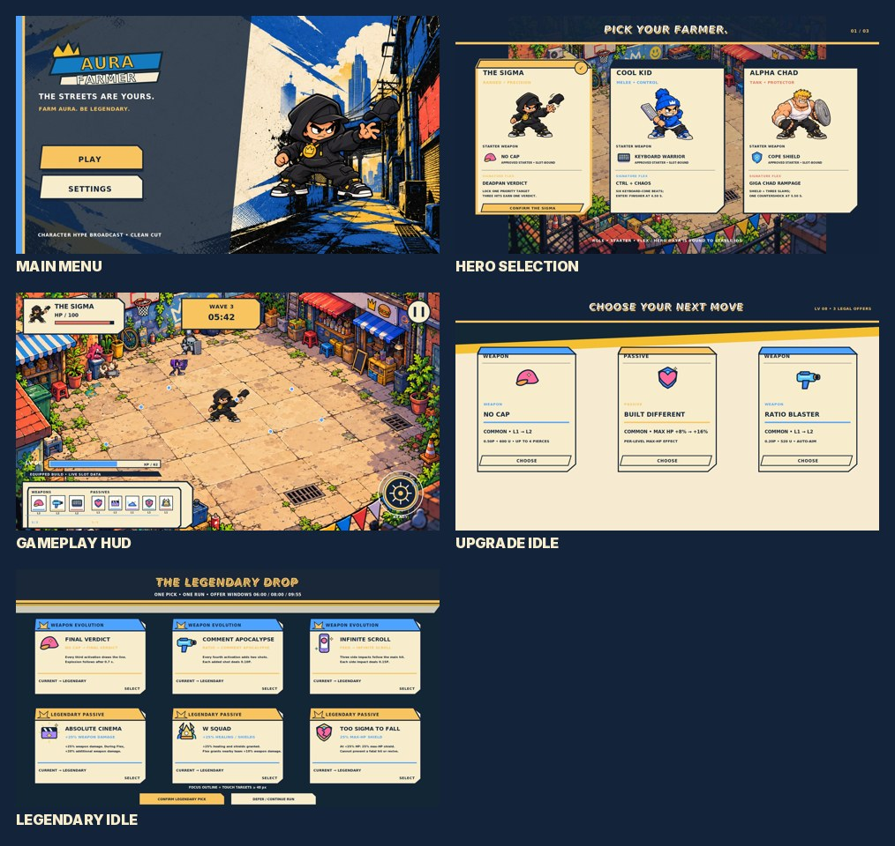

# Clean Cut final corrections — candidate package

**Review state:** selected visual direction accepted; these corrections are production candidates pending explicit creator approval. Keep PR #69 open and unmerged. Earlier Clean Cut and HUD packages remain intact as comparison baselines.

This package contains updated Main Menu, Hero Selection, Gameplay HUD, three-card upgrade and six-card legendary compositions; responsive mobile layouts; isolated component SVGs and transparent PNG exports; before/after references; source hashes and developer handoff.

## P0 joystick replacement

The previous diamond/plus joystick is superseded for proposed final use. The new control uses a perfect translucent circular outer ring and independently movable circular thumb, with idle/pressed art and activation ripple. Outer radius is 80 reference units, thumb radius 35, documented saturation travel 119. Five 915×412 examples show left/center/right, dual-finger Flex and dense combat. There is no permanently visible stick.

## HUD and choice work

The Gameplay HUD displays three weapons and five passives from their exact approved PNG sources, with a separate build-inspection panel and empty/filled/focus/selected equipment frames. Each of the three MVP heroes has a circular Flex control in seven visual states. Upgrade cards have type-aware frames and hover/focus/selected/pressed states with comparison and confirmation examples. Legendary choice uses three compatible weapon evolutions plus three legal passive buffs, explicit selected/confirmation/defer states and canonical offer windows.

## Verification

- 37 icon hashes match the creator approval register; no approved icon/master is edited.
- All SVG sources parse and relative references resolve; 79 component SVGs have transparent PNG exports.
- High-density, boss, normal gameplay, active Flex, and mobile-combat art previews are labeled as production art references, not runtime captures.
- Game values in UI previews are examples; live values and states must bind to canonical simulation data.
- No Godot runtime/scenes/gameplay, GDD, or Phaser files are modified. Runtime input ownership, device ergonomics, FPS and balance are not validated by static art.

See `CLEAN_CUT_FINAL_SPEC.md`, `GODOT_HANDOFF.md`, `STATE_AND_MOTION.md`, `REVIEW_MATRIX.md`, and `manifests/`.
