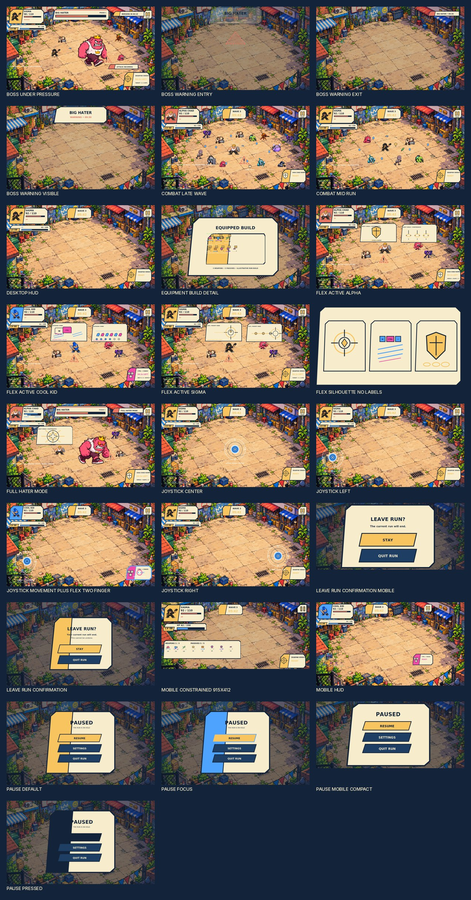

# Clean Cut Gameplay HUD — Final Polish v1

**Creator review:** visual direction accepted; these individual assets are production candidates pending explicit creator approval. PR #69 remains open and unmerged.

This is a preservation-first continuation of `../gameplay-hud-rework/`. It does not redesign the direction. The earlier rework and the originally rejected HUD remain untouched as review baselines; this package is the newest HUD candidate.

## Screen previews and editable sources

- Desktop HUD; mobile landscape; constrained 915×412 landscape.
- Floating joystick at left, center and right; two-finger movement plus Flex reference.
- Mid-run and late-wave combat density; active Sigma, Cool Kid and Alpha Flex; no-label Flex silhouette comparison.
- Boss warning entry/full/exit; boss under pressure; FULL HATER MODE.
- Pause default/focus/pressed/mobile compact; leave-run confirmation for desktop and mobile.
- Equipment-build detail demonstrates three weapon slots and five passive slots.

Every composition is a visual review reference. Use the isolated SVGs/transparent source crops in `shared/` and `source/` to build responsive, state-bound Godot Controls. Do not use a full-screen preview as a runtime texture.

## Quality and provenance

The 37 creator-approved icon PNGs are referenced unchanged from v1. Touch Grass resolves only to `icon-clean-cut-v2-256.png`. All six approved character/environment/enemy masters retain verified source hashes. Enemy frame crops follow the approved `enemy-frames.json` rectangles. New illustrations, component frames, Flex VFX, pickups, UI treatments and compositions remain candidates pending creator approval.

See `ART_SPEC.md`, `IMPLEMENTATION_HANDOFF.md`, `STATE_AND_MOTION.md`, `SUPERSESSION.md`, and `manifests/` for approved tokens, V5 rule changes, dimensions/anchors, state sequencing, source paths, hashes and review status. Static mockups do not validate pointer ownership, multitouch, gameplay, balance, or device acceptance.
