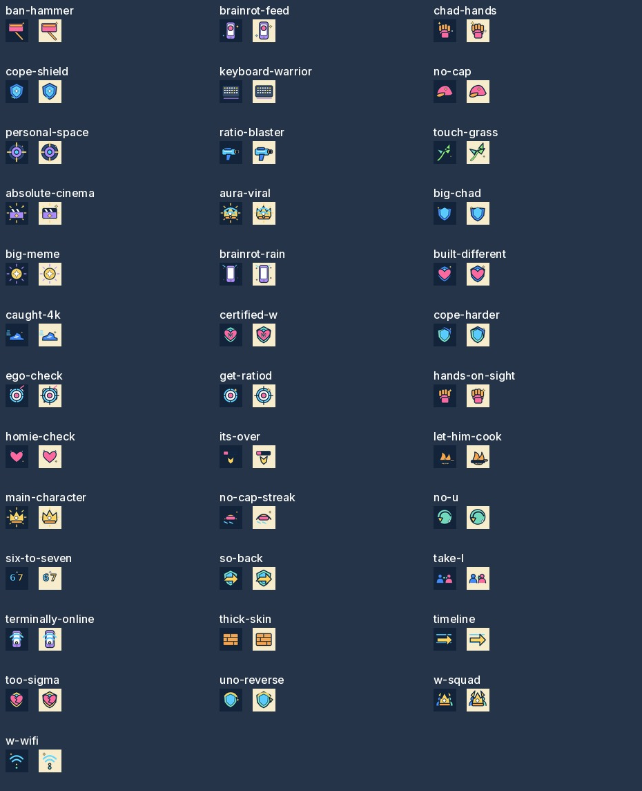
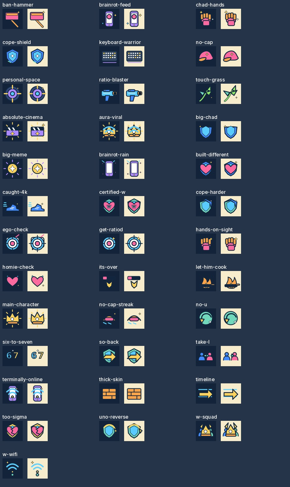

> **Current update — 24 October 2026:** The creator explicitly approves 37 exact PNGs: eight V5 weapons, 28 V5 passives and Touch Grass Clean Cut v2. Clean Cut is the selected visual refinement recorded in GDD §26. All selected copies are hash-verified and promoted; 32 current items use live bindings, five future-only passive artworks remain unoffered. See `docs/art/CREATOR_ICON_APPROVAL_2026-10-24.md` and `docs/art/CLEAN_CUT_INTEGRATION_ACCEPTANCE.md`. Earlier zero-approval/blocked statements below are historical checkpoints. Original source isolation and all gameplay rules remain intact.

# Clean Cut V5 creator review package

Source checkpoint: `ab35ff9c21353842748a503f45729c27ce9e5619`. No source bytes changed. **37 candidates audited, zero selected/approved/promoted.** [Exact technical records](CLEAN_CUT_ICON_AUDIT.json) include every ID, PNG/SVG hash, margins, playable scope and effect. All 83 declared file hashes match. All 37 SVGs decode with the actual Godot 4.7.2 Image decoder; none embeds a raster. PNGs are 256×256 RGBA with transparency. No byte-identical canonical PNGs or canvas clipping were found. A 12px margin is an audit heuristic, not a new art specification.

[Open the self-contained review](evidence/clean-cut-review/review.html). It is a read-only review package; it does not confer approval or modify the repository. The creator may approve/reject individual exact ID/version/hash rows, or an explicitly enumerated batch, with a conversation/issue reference. Touch Grass requires an explicit V5 versus Clean Cut v2 choice. Conditions and rejected items must be retained. Never mark a draft, CI pass, merge or broad style approval as creator authorization.

## Findings requiring creator/art-production review

- `six-to-seven`: Godot SVG text differs materially from the supplied PNG (RGBA mean absolute channel difference 16.20/255). `certified-w`: W font differs (2.60/255). Other pairs are below 0.5/255. These measurements support source correspondence, not pixel identity or artistic approval. Prefer exact reviewed PNGs for runtime; request outlined-text versioned SVGs if editable-source parity is required. Do not overwrite current files.
- `let-him-cook`: right alpha margin is 9px. `caught-4k` and `ego-check` have 10px minimum margins. None is clipped, but inspect icon-well padding before acceptance.
- Shield/heart family (`cope-shield`, `built-different`, `cope-harder`, `certified-w`, `big-chad`, `too-sigma`, `so-back`, `uno-reverse`) shares blue shield silhouettes. Fist family (`chad-hands`, `hands-on-sight`) and target family (`personal-space`, `get-ratiod`, `ego-check`) also require labels at compact sizes. Do not substitute similar icons for missing IDs.
- Many candidates contain accent stars/sparkles despite Clean Cut's restraint requirement. Existing masters are preserved. The creator must explicitly retain these or request versioned refinements; no new decorative art is added here.
- `its-over` has a very small low-HP bar at 32px; `let-him-cook` loses pan detail; the W and 6/7 text are tiny. At 64px silhouettes and details improve. Cream wells preserve dark outlines much better than navy. Item names/effects and category labels remain essential; this is not final compact-UI acceptance.
- Effect metaphors are broadly recognizable (weapon object, movement shoe, HP heart/shield, range arrow, frequency phone/Wi-Fi). The source metaphor is not a promise of an extra mechanic. `personal-space` is a pulse, not target marking; `no-u` is a timed debuff pulse, not reflection; `too-sigma` cannot prevent a fatal hit. UI text stays canonical.
- Future-only `get-ratiod`, `ego-check`, `uno-reverse`, `brainrot-rain`, `take-l` remain outside the approved 23-passive offers. Art registration cannot enable them.
- Touch Grass v2 is a distinct shaded three-leaf whip, supplied as raster only. [Side-by-side](evidence/clean-cut-review/touch-grass-variants.jpg) shows both at 256/64/32. It must never inherit the V5 SVG or approval. Selection remains pending.

## Source evidence and boundaries

Five `masters-*.jpg` sheets in the review show every source at 256px on both backgrounds. These are labelled source composites, **not live card/HUD screenshots**. `tests/review_icon_sources.gd -- ABS_SCRATCH_OUTPUT` decodes SVGs without importing/promoting candidates. Actual selected normal/legendary cards, equipment replacement, focus/touch, five viewport captures and pack verification belong to the independent runtime pipeline milestone; candidate activation remains approval-blocked.

## Exact pending approval checklist

| Kind | ID | Selected version | PNG SHA-256 | Decision / reference |
| --- | --- | --- | --- | --- |
| weapon | `ban-hammer` | None; V5 candidate offered | `086c4640501549e1fa73cbd2463d57b5feb6b02f8ae821b2634ad7ba37a17c49` | Pending / none |
| weapon | `brainrot-feed` | None; V5 candidate offered | `4e5bd2ac7793b760e9b2cea03ae301affa7e463a877ddeafe383f320bcc1731b` | Pending / none |
| weapon | `chad-hands` | None; V5 candidate offered | `08f7ace71a60b33f81320ce9dcaad6be48985b57fbd61717322cec7e0c2437ab` | Pending / none |
| weapon | `cope-shield` | None; V5 candidate offered | `37a5f0adcb9d18726974c893822bf5fd74f275f01872b908c2c5b2d9a8be0662` | Pending / none |
| weapon | `keyboard-warrior` | None; V5 candidate offered | `66327595d20404f1d6eae7aefb7b6ab934e79a91336dea4581fdb5fc0b3ad3a1` | Pending / none |
| weapon | `no-cap` | None; V5 candidate offered | `b33607b9617a5af4f7ee95e6df031c88317c4075779e5e3412b871c062ecb1e5` | Pending / none |
| weapon | `personal-space` | None; V5 candidate offered | `1c0a93b8e910a177dcc63d907d33b6349b1bb6d5df074f659e0c0732c2d855f6` | Pending / none |
| weapon | `ratio-blaster` | None; V5 candidate offered | `687c5ec21d449efa0fb8281390523fd26f3ae47d700105c82bbae9ded1c59494` | Pending / none |
| weapon | `touch-grass` | None; V5 candidate offered | `78688d95831b2106a0b62f6cbf8121d1fd42a3437329ee62b14dac3f3086f861` | Pending / none |
| passive | `absolute-cinema` | None; V5 candidate offered | `f72bb950d20e5d673c2c0d3b86ce1f244c2127a625582cbffc53a60600b95842` | Pending / none |
| passive | `aura-viral` | None; V5 candidate offered | `825c3962a624209937dee9d2299cdbf4618ff1009cf4d0e46bc8e0e7a10a2d89` | Pending / none |
| passive | `big-chad` | None; V5 candidate offered | `ab6b052f52e5893673481fc6b680dc7bd48ad0ef2747dc2b134f0089c13789f9` | Pending / none |
| passive | `big-meme` | None; V5 candidate offered | `4eb0df69bfe1cc95860fba3f947e711865e86cf01fd10b7a44b2b4b027adb755` | Pending / none |
| passive | `brainrot-rain` | None; V5 candidate offered | `774d2f5c39526e968c57480c388fd0d8f4fbd91d76a09d91f945d8b66749a0a3` | Pending / none |
| passive | `built-different` | None; V5 candidate offered | `7014b105250052dc810d13dc113a30fd9c5db8f0a3789512f9557019bce9875b` | Pending / none |
| passive | `caught-4k` | None; V5 candidate offered | `d5703ddec94bdd13355f7486ebb06467b9b5b404c0d068e618441af49483c845` | Pending / none |
| passive | `certified-w` | None; V5 candidate offered | `13fa2c2a3463b60968b83901c1c9e04bbc0a64886bc90c42f429ef3bada2a735` | Pending / none |
| passive | `cope-harder` | None; V5 candidate offered | `60c35a5ef14232607d007ef9facb8d2988376bb97ddc85151cfa7e8477237167` | Pending / none |
| passive | `ego-check` | None; V5 candidate offered | `5f0c6cb86f2b92b6ef64f9a0e743d72c9b42cf774f3ddc24ca334f61abd00eba` | Pending / none |
| passive | `get-ratiod` | None; V5 candidate offered | `dc71c5118537d8bba52b68ca6f6d428acc6cd7a3b1d75cf916f2fea7cbd5f3ec` | Pending / none |
| passive | `hands-on-sight` | None; V5 candidate offered | `0e7257e458fc2654cb6aca40c7b6650356e01238ffdc682fb72d5c3d970c77fd` | Pending / none |
| passive | `homie-check` | None; V5 candidate offered | `3ba98e6b4165efa1147ba45835229f214b6790e6b42acf74203bf1a88bbcccc1` | Pending / none |
| passive | `its-over` | None; V5 candidate offered | `afc514a7cded5580e4993bd93fe5173aa94962c1bd4951130b58a0cd5215c4a0` | Pending / none |
| passive | `let-him-cook` | None; V5 candidate offered | `74f0e4ef3cb64fd503a9cd7fe544828e061429c745bd50ce43edd37d8f0ce843` | Pending / none |
| passive | `main-character` | None; V5 candidate offered | `fba7de037c5e90b146cc0736d02335f902620886132c1d658a2fbd3d29581362` | Pending / none |
| passive | `no-cap-streak` | None; V5 candidate offered | `bcf52b247f7e89dd3a3d09bc33cc8703dfa9477ba92e870dc806aea1c41d18b2` | Pending / none |
| passive | `no-u` | None; V5 candidate offered | `08e9daf06bd4a5de59111fc59e12943ddc0a3ce29af0b7236e74bbf26c8f0c8a` | Pending / none |
| passive | `six-to-seven` | None; V5 candidate offered | `233ead25635e6a6e3044242035fc07a5507689c13c79e07cd76ea3006e946afb` | Pending / none |
| passive | `so-back` | None; V5 candidate offered | `a804cd0590d89d7828d6029fba4105a8f4d51f121e87928d3be19cfe8ed2134c` | Pending / none |
| passive | `take-l` | None; V5 candidate offered | `c3426189f6b3f9cbeadf68ba9b61ed9989dd9af98e160b45741943f6f12c99b7` | Pending / none |
| passive | `terminally-online` | None; V5 candidate offered | `a60fe0a71e9a6afb19b6f9fcbbabcfa9adea6698b0c1755419fb9ced9f99d961` | Pending / none |
| passive | `thick-skin` | None; V5 candidate offered | `b00baa75d140eff6185cd9ceb90bef5a431fd27da02d1e7a06ffed683b22cf92` | Pending / none |
| passive | `timeline` | None; V5 candidate offered | `4b6200864a17e6c77a2f55a9069db190deda46a65ea38d3fae2010d3cb774215` | Pending / none |
| passive | `too-sigma` | None; V5 candidate offered | `5c72ffefd0ec512796676248a9620fc42505a0b72e8da30e119deb897329e011` | Pending / none |
| passive | `uno-reverse` | None; V5 candidate offered | `d2a4e14ba78e5ea6988e6fd6d2e8075455eef9ea96c8f7d3c3c1a7da2e12f4d6` | Pending / none |
| passive | `w-squad` | None; V5 candidate offered | `e82fe5d2c219d27223a7da2a3f5271f8368905e59ab82ad462d344cd7790e853` | Pending / none |
| passive | `w-wifi` | None; V5 candidate offered | `4b69cedf30a0111df3cdf2aefae093427bb3fc497622b91884607a14cbc6f0bc` | Pending / none |

Reproduction: run `godot --headless --path . --script res://tests/review_icon_sources.gd -- /absolute/scratch/svg-renders`, then `python3 scripts/review_clean_cut_icons.py --svg-renders /absolute/scratch/svg-renders` (Pillow/NumPy required for this offline review). This regenerates source audit JSON and sheets; it cannot grant approvals or copy runtime art.
