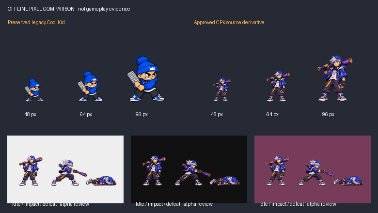
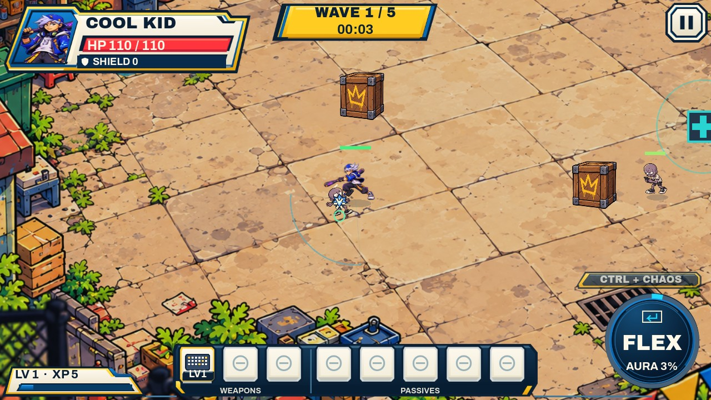

# Cool Kid CPK v1 integration — technical review

The creator-approved Cool Kid artwork now renders in the actual Godot game: selection/HUD portrait and idle, movement, melee, hurt, Flex and defeat. The old approved files remain intact for rollback. This is an implemented **Draft**, not a release or a claim that every acceptance gate is green.

## Provenance and scope

- Game base: `a7695eb86a659fc8b9e065960aee0951ddfdb900` (merged Pixel Vixen #123).
- Exact final gameplay / targeted-test commit: `fb5f09a9dd4cbf12a2b5293ee9b5cf1acf2132f7`. Later commits add import settings already used in testing, evidence and this report; they do not change simulation or animation code.
- [Art PR #17](https://github.com/pedro-ai-coder/clutchpunks-art-pipeline/pull/17), package commit `fb3809f76cea94ececc18bfbfe0b03ff68417cbc`.
- Source: `source/characters/cool-kid/cpk-v1/cool-kid-cpk-approved-source.png`, 1254×1254 RGBA. SHA-256 `c50232da6978c9751768319f1f59454cff548173cc0bd5b15f7a1d206f649ddf`; Git blob `08810472f1a95cddc745869fa57684e6e6b6fe3f` independently checked before and after extraction. Approval `CPK-ART-COOL-KID-2026-11-10-01`.
- Runtime atlas SHA-256: `0a190b57982dfd8556da6b8e05cf38aae4f83e392461ef8a6c2bb42c2340925d`. The separate decoded imported RGBA hash is in the manifest and renderer, and works when original PNGs are absent from an exported PCK.
- Canon #33 remains **open/unmerged**. GDD V3 remains operational authority. No manifest claim was substituted for byte verification.

`assets/production/cool-kid/cpk-v1/manifest.json` records source bounds, stance origins, per-frame hashes, runtime mapping, timing, import hash and package commit. The art repository owns the reproducible generator and 49 standalone derivative masters. Segmentation follows connected silhouettes after removing low-alpha board noise, not equal grid cells. Each gameplay pose uses one 0.5 scale in a 144×144 cell, foot origin (72,120), rendered at 0.75 (standing body about 63 pixels). Extended bat poses have transparent padding. The portrait is a separate native-resolution crop of pose 0.

Only the original `cool-kid` presentation selects the new adapter. Female `cool-kid` remains Byte Baddie. Canonical state precedence comes from the existing animation controller. Melee uses raised-bat anticipation and switches to execution at the existing `attack=0.145` impact descriptor; the 0.22-second attack window, 0.18-second hurt window, 4/9-second gait cycle and 0.375-second defeat settle deadline are retained. Flex entry/active/exit follows existing timers. No rules, stats, movement speed, collision, weapons, progression, RNG or save schema were edited.

## Visual evidence

**Offline previews — not gameplay:**



[All 49 isolated poses](evidence/cool-kid-cpk-v1/49-pose-contact-sheet.png) · [Offline run/melee playback at 48/64/96 pixels](evidence/cool-kid-cpk-v1/offline-motion-scales.gif).

**Actual native gameplay, real-time automated input:**



[Hero selection](evidence/cool-kid-cpk-v1/gameplay/01-hero-selection.jpg) · [Idle/start](evidence/cool-kid-cpk-v1/gameplay/02-normal-start.jpg) · [Movement](evidence/cool-kid-cpk-v1/gameplay/03-movement.jpg) · [XP upgrade](evidence/cool-kid-cpk-v1/gameplay/05-xp-upgrade.jpg) · [Damage](evidence/cool-kid-cpk-v1/gameplay/06-damage.jpg) · [Flex](evidence/cool-kid-cpk-v1/gameplay/07-flex.jpg) · [Defeat result](evidence/cool-kid-cpk-v1/gameplay/08-result.jpg) · [Restart](evidence/cool-kid-cpk-v1/gameplay/09-restart.jpg).

The run reached **87.793 seconds, 65 kills, 150 XP, level 3, two chosen upgrades, one Flex and natural defeat**, then restarted with 110 HP. Wall time was 88.681 seconds. No invulnerability, accelerated clock, spawned fixture enemies, XP grants or damage injections. Input is automated, not a human playtest; profile writes are isolated. [Machine-readable gameplay report](evidence/cool-kid-cpk-v1/gameplay/gameplay.json) and its final error log record **zero input errors and no Godot script errors**. Earlier capture attempts were superseded after correcting the review harness's pre-run snapshot and waiting for the Flex button to become interactable.

## Executed validation

Engine: **4.7.2.stable.official.ed1daf0bf**, Windows, Compatibility/OpenGL 3.3, AMD Radeon RX 6800 XT.

| Check | Actual result |
|---|---|
| Exact source hash/blob and immutable original | PASS |
| Art generator + three Python tests, including byte-identical rebuild | PASS |
| New Godot atlas/import/alpha/padding/state/timing/negative-integrity tests | PASS |
| Original/Byte Baddie exact gameplay and RNG parity | PASS, 720 per-step comparisons |
| Existing weapon parity | PASS, 3,456 per-step comparisons |
| Remaining existing gameplay/UI/appearance/Flex/save/asset checks | Executed; see logs |
| Existing validation script Godot phases, including continuations | **78 PASS / 1 FAIL / 0 NOT_RUN** |
| `frame-pacing-state` golden-state comparison | **FAIL on this branch AND unchanged main** |
| Web PCK export, imported texture/manifest presence, actual PCK renderer activation | PASS |
| Normal native gameplay through combat/XP/damage/Flex/defeat/restart | PASS, nine real captures |
| Browser/WebGL gameplay | NOT_RUN; native gameplay and PCK verification do not imply browser validation |

Commands actually executed (Windows used a local PATH wrapper for the existing `godot`/`python3` command names):

```text
godot --version
bash scripts/validate.sh
python scripts/verify_cool_kid_cpk.py
godot --headless --path . --script res://tests/test_cool_kid_cpk_art.gd
godot --headless --path . --export-pack Web build/cool-kid-validation/game.pck
python scripts/verify_cool_kid_cpk.py build/cool-kid-validation/game.pck
godot --headless --path . --main-pack build/cool-kid-validation/game.pck --script <absolute-path>/tests/test_cool_kid_cpk_export.gd
godot --path . --audio-driver Dummy --rendering-driver opengl3 --script res://tests/capture_cool_kid_cpk.gd -- <output-directory> fb5f09a9dd4cbf12a2b5293ee9b5cf1acf2132f7
godot --headless --path <unchanged-main-worktree> --script res://tests/frame_pacing/state_trace.gd
```

The full validation script stops at the failing golden-state comparison. Its remaining exact commands were executed in continuation wrappers; the original roster test expected the legacy `atlas` sheet and was updated specifically for original Cool Kid's `cool-kid-cpk` sheet, then passed. The final targeted test also rejects a changed pixel without modifying the cached source texture. [Per-phase summary](evidence/cool-kid-cpk-v1/validation-summary.json) and [logs](evidence/cool-kid-cpk-v1/validation) retain failures and successful reruns transparently. Initial Windows CRLF checkout conversion broke existing hashed JSON/shader sources; local bytes were restored to the repository versions, with no unrelated source edits committed.

The baseline failure was reproduced in a separate unchanged worktree at `a7695eb86a659fc8b9e065960aee0951ddfdb900` using the same engine. Its cause is **not established**. No golden reference was rewritten to hide it. Therefore the complete mandatory validation gate is **not green**.

## Outstanding review and rollback

- **Missing artwork:** no rear/front directional run is authored in the approved board. All headings explicitly use side running with horizontal mirroring. No rear pose was fabricated or substituted from another design.
- The extracted rise/intro row is archived but inactive; there is no existing intro state to bind. Additional entry mechanics were not introduced.
- Creator visual acceptance of the normalized derivative and native motion is pending. Offline inspection found clean edges, stable global scale and padded bat extents at 48/64/96 pixels; this is not artistic sign-off.
- Motion Design #122 remains open/draft at `de653dbeba220d2e2a1f2ad881b5947175a22756`. Its patch was inspected and a read-only `git merge-tree` test found conflicts in `approved_visuals.gd` and `validate.sh`. None of that experimental motion code was incorporated. A later reconciliation must apply its optional body transform to this new atlas branch and recheck attached weapons/reduced motion.
- **Merge readiness: not ready** while the mandatory baseline-state failure and creator visual review remain outstanding. Browser gameplay is also unverified.

Rollback: revert this focused game PR to restore the previous renderer and portrait. All `assets/approved/cool-kid*.png` files, old frame geometry and canonical animation controller remain byte-for-byte unchanged. If the new atlas cannot be verified, the runtime also chooses the legacy pose path. There is no save or gameplay-data migration. The art PR can be reverted independently without touching its approved source. No merge, deployment, public release or automatic release workflow was initiated.
