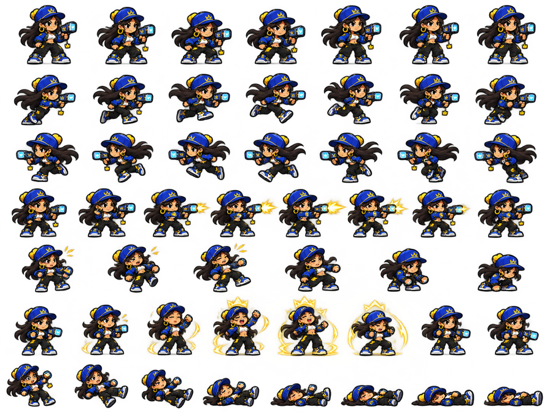
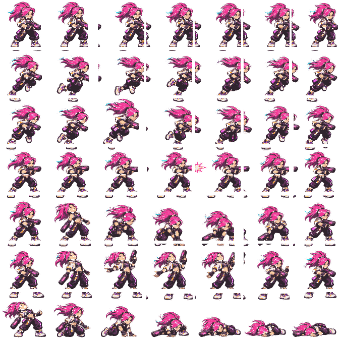

# Pixel Vixen — Creator-Approved CPK Art, Actually Imported

**Status:** APPROVED ORIGINAL IMPORTED / DERIVATIVE ATLAS COMMITTED / NATIVE GODOT QA PENDING  
**Scope:** The `Pixel Vixen` female appearance of the existing `sigma` kit only.  
**Art provenance:** original `sprite_atlas_da_pixel_vixen_em_ação.png` selected and approved by creator in CLUTCHPUNKS conversation; **not** the later, rejected `folha_de_sprites_da_pixel_vixen.png`.

## Before / after — view images directly in this PR

| BEFORE — original V2 currently on main | AFTER — approved CPK derivative committed in this PR |
| --- | --- |
|  |  |
| Old dark-haired / blue-and-yellow version, with rejected generic crown symbol. | Pink/cyan-haired **creator-approved** cartoon design, clean-cut colored 49-frame sheet, transparent red-background cleanup. |
| [Open V2 exact source](https://github.com/pedro-ai-coder/aura-farmer-godot/blob/e43236014044533bad41c944222736cce441cf5f/assets/art-candidates/pixel-vixen/v2/pixel-vixen-atlas-v2.png) | [Open new real PNG in this PR](../../assets/production/pixel-vixen/cpk-v1/pixel-vixen-cpk-v1-atlas.png) |

## Real, verified asset files

- **Approved original master, actually preserved in art repository:** [Pixel Vixen original full PNG](https://github.com/pedro-ai-coder/clutchpunks-art-pipeline/blob/b34939c4c2af8f14d7207e54a86d157fe77e7ce6/source/characters/pixel-vixen/creator-approved/pixel-vixen-approved-source.png). Source **1254×1254 RGBA**, **2,652,554 bytes**, SHA-256 `5a16816eb51b6ca1d5e3f7f4036064243bd7152d561fdf866c5bd543ca29b490`; exact Git blob `fbb9bd898dbcdd8566ffc465eb0a8888982b00d5`.
- **Production PNG imported in this Godot PR:** [Pixel Vixen CPK v1 atlas](../../assets/production/pixel-vixen/cpk-v1/pixel-vixen-cpk-v1-atlas.png), **672×672 PNG** with 49 cells of **96×96**, indexed 64 colors with transparency; **96,526 bytes**, SHA-256 `4058de734cd81eb29656267bede422756555dbf02d0680f20a91d609f9f05c63`; exact Git blob `0f96095995c2c760a70192eb499fb18e3494a609`.
- **Game manifest:** [manifest.json](../../assets/production/pixel-vixen/cpk-v1/manifest.json).
- **Art export source and manifest:** `pedro-ai-coder/clutchpunks-art-pipeline` PR on `art/pixel-vixen-approved-source-and-godot-export-2026-11-10`.
- The new renderer is `scripts/approved_visuals.gd`; it compares **the actual PNG SHA-256**, then draws the new atlas in the existing Pixel Vixen animation path.
- The existing V2 atlas and existing Sigma gameplay mechanics remain in the tree as historical/fallback material. When the new file is present and verified, the new art is selected.

## Animation contract — no new gameplay kits

| Existing presentation state | New atlas cells | Source |
| --- | --- | --- |
| Idle | 0–6 | Original approved row 1 |
| Move forward | 7–13 | Original approved row 2 |
| Move sideways | 14–20 | Original approved row 3 |
| Primary ranged attack | 21–27 | Original approved row 4 |
| Hurt | 28–34 | Original approved row 5 |
| Flex visual accompaniment | 35–41 | Original approved row 6 |
| Defeat | 42–48 | Original approved row 7 |

**Technical limits:** the source is a 7×7 drawing, not a perfect eight-direction game rig; current horizontal mirroring and 7-slot state timing are inherited from the existing Pixel Vixen animation controller. Visual Flex frames **do not** modify the canonical `Deadpan Verdict` effect. Final intro/rear-camera animation remains a separate task.

## How to verify on the PR

1. In **Files changed**, confirm `assets/production/pixel-vixen/cpk-v1/pixel-vixen-cpk-v1-atlas.png` is a **real binary file** rather than a text link.
2. Compare the old and new PNGs above; focus on recognizable silhouette, less visual noise, transparent edges and clean-cut cartoon readability.
3. In CI, run `bash scripts/validate.sh`; the new `pixel-vixen-approved-cpk-atlas` phase runs `res://tests/test_pixel_vixen_cpk_art_gate.gd` and checks source SHA, 49 slots, Sigma pose parity and imported texture.
4. In a native Godot real run, select the female `sigma` appearance, observe idle/run/attack/hurt/Flex/defeat, verify XP/weapon and summary still work, and compare scale with other heroes.
5. Do not infer actual Godot visual/gameplay success from the static PNG or local HTML. **Native QA and four-browser verification have not yet been reported as completed.**

## Approval boundaries and rollback

**APPROVED:** original exact creator-selected Pixel Vixen drawing.  
**IMPLEMENTED IN FEATURE BRANCH:** indexed/transparent technical derivative atlas, renderer selection, SHA-pinned manifest and integration gate.  
**NOT YET VERIFIED:** Godot native import/run, silhouette at normal Level Zero scale, complete real victory and loss, site export and final public release.

The gameplay kit remains `sigma`, with its existing No Cap, Deadpan Verdict, RNG, progression, save keys and balance unchanged. No production branch merge or deployment is implied. Roll back the renderer change and asset file if tests show regressions; original and V2 art sources remain intact.
