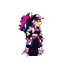

# Pixel Vixen — Before / After and Animation Review

**Review date:** 2026-11-09  
**Scope:** Real visual comparison for Draft PR #123, **not a verified game build**.  
**Product:** CLUTCHPUNKS / original clean-cut cartoon visual identity approved under `CPK-VISUAL-2026-11-09-02`.  
**Main remains unchanged:** the Godot 4.7.2 `sigma` gameplay kit and existing female V2 appearance are the currently available actual game assets.

## 1. Compare the artwork side by side

| **BEFORE — current V2 art in Godot main** | **AFTER — experimental clean-cut artwork** |
| --- | --- |
|  |  |
| [Open V2 atlas source](https://github.com/pedro-ai-coder/aura-farmer-godot/blob/e43236014044533bad41c944222736cce441cf5f/assets/art-candidates/pixel-vixen/v2/pixel-vixen-atlas-v2.png), 896×672, 49 logical slots and irregular 51 source poses | **72×72 thumbnail committed to this PR.** New 672×672, 49-pose production-trial atlas is in the attached **creator-facing local ZIP only**, **not in this PR**. |
| Dark hair, blue/yellow clothing, generic crown mark. Original V2 is still what current gameplay uses. | Pink/cyan hair, original CPK mark, cartoon clean-cut. Automated matte edges, Flex and motion consistency **need creator art review**. |

These pictures are **not the same scale**, so do not judge animation smoothness or attack timing from the static table. Open the new animation preview in the downloadable package; the thumbnail only confirms **which specific new design** the PR is discussing.

## 2. Where is the actual motion preview?

The user-facing **PixelVixen_Review_Pack_2026-11-09.zip** from the CLUTCHPUNKS ChatGPT conversation contains:

| File | Opens without Godot? | Purpose |
| --- | --- | --- |
| `PixelVixen_Animation_Review.mp4` | **Yes**, ordinary video player | 12-second labelled playback of idle, run, attack, hurt, provisional Flex and defeat; not interactive gameplay |
| `PixelVixen_Animation_Review.gif` | **Yes**, browser/image viewer | Same sprite animation loops without installing tools |
| `PixelVixen_Interactive_Offline.html` | **Yes in desktop browser after extracting ZIP**, but may be blocked by ChatGPT's embedded viewer | Actual keyboard-controlled art sandbox: WASD/arrows move, Space attack, H hurt, F provisional Flex, K defeat, R reset |
| `PixelVixen_Before_After_Trials.png` | **Yes**, image viewer | Earlier overly pixelated technical trial vs current clean-cut trial; **not** V2 Godot capture |
| `PixelVixen_Atlas.png` | Yes, image viewer | Full new 672×672 RGBA atlas |
| `PixelVixen_QA_Sheet.png` | Yes, image viewer | Labels for 7 rows of animation |

**File availability boundary:** these files are provided in the ChatGPT conversation as an owner-facing local review ZIP; they have **not** been uploaded to GitHub. GitHub cannot link to sandbox attachments. **Do not pretend this PR contains the video, GIF, the original art board or full atlas.** The small PNG shown above **is** genuinely committed to this branch.

### Quick instructions

1. Download `PixelVixen_Review_Pack_2026-11-09.zip` from the ChatGPT delivery message.
2. Extract the ZIP first; do not open its HTML from the archive preview.
3. Open `PixelVixen_Animation_Review.mp4` or the GIF to inspect motion reliably on mobile/desktop.
4. For keyboard interaction, open `PixelVixen_Interactive_Offline.html` in Chrome, Edge, Firefox or Safari on a desktop. The embedded PNG is self-contained; no external assets or localhost server required.
5. If HTML is blocked by a corporate/security policy or the ChatGPT viewer, use the MP4; this does **not** establish compatibility with the four actual game browsers.

## 3. What has actually changed in PR #123?

**Changed in this draft PR:** `scripts/approved_visuals.gd` has an opt-in loader for the new **exact SHA-pinned** 49-frame image and a new `tests/test_pixel_vixen_cpk_art_gate.gd` that deliberately **blocks** if the PNG is missing or mismatched. Current `sigma` kit logic, Flex mechanics, content IDs and saves stay unchanged.

**Not changed:** `main`; the current V2 PNG; combat scripts; Level Zero game scenes; six-hero kit mapping; public site assets.

**Critical blocker:** `assets/production/pixel-vixen/cpk-v1/pixel-vixen-cpk-v1-atlas.png` is still **missing from GitHub**, despite existing in the local review pack with SHA-256 `65a724ba088ee15d765bdc8c22b96f28fb50a007d7621eafa7a25f0682a64b24`. The new renderer intentionally displays **V2** until exact bytes are available.

## 4. Animation coverage and acceptance status

| State | New technical preview | Godot native | Creator final approval |
| --- | --- | --- | --- |
| Idle, 7 slots | Offline preview available | NOT RUN | PENDING |
| Move front / side, 14 slots | Offline preview available | NOT RUN | PENDING |
| Attack, 7 slots | Offline preview available | NOT RUN | PENDING |
| Hurt, 7 slots | Offline preview available | NOT RUN | PENDING |
| Flex, 7 slots | **PLACEHOLDER visual poses**, not dedicated Flex | NOT RUN | **NOT READY** |
| Defeat, 7 slots | Offline preview available; matte cleanup needed | NOT RUN | PENDING |
| Rear-view entry cinematic | Three isolated proposal poses, no integrated animation | NOT RUN | NOT READY |

**No full run, no Godot/Web export and no Level Zero browser QA have been executed for this new atlas.** Reported prior Chromium art-only state checks are not normal Godot gameplay evidence. Do not merge or call this asset final until the actual binary is imported, tested at game scale and independently approved.

## 5. What I need to see before the implementation is ready

- [ ] Exact new atlas source binary committed and SHA-256 verified in both art and game feature branches.
- [ ] Authored proper Flex animation and polished alpha/foot pivots without stray fragments.
- [ ] Native Godot import and unit/animation tests with exact engine version and SHA.
- [ ] Real Godot run: auto-attacks, XP/upgrade/Flex, damage, death and restart for Pixel Vixen.
- [ ] Actual 48/64/96px capture compared with all three kit families and new Level Zero environment.
- [ ] Creator approval of final sprite motion; merge and public release remain separate creator decisions.

**Rollback:** remove the version-gated rendering change; current V2 resources stay intact.
