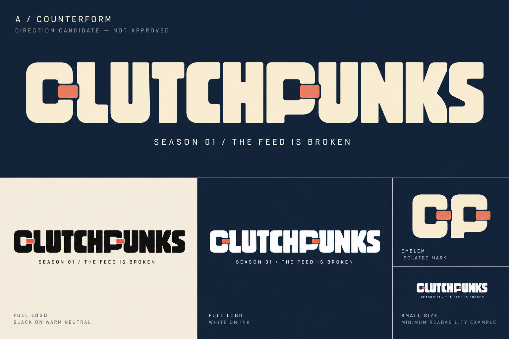
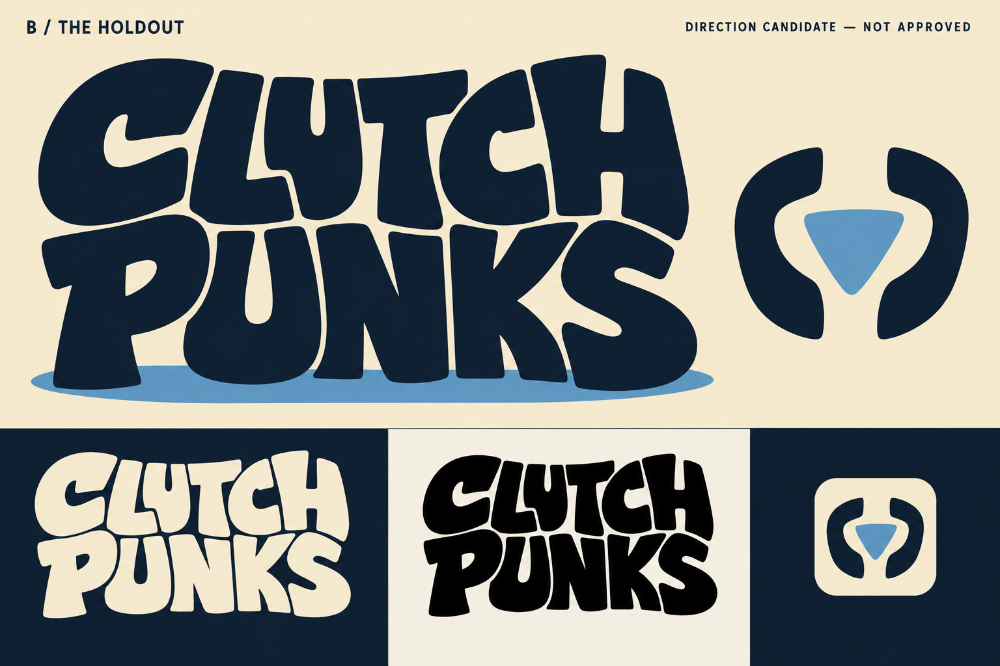
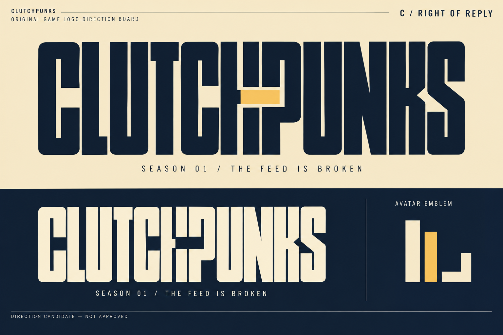
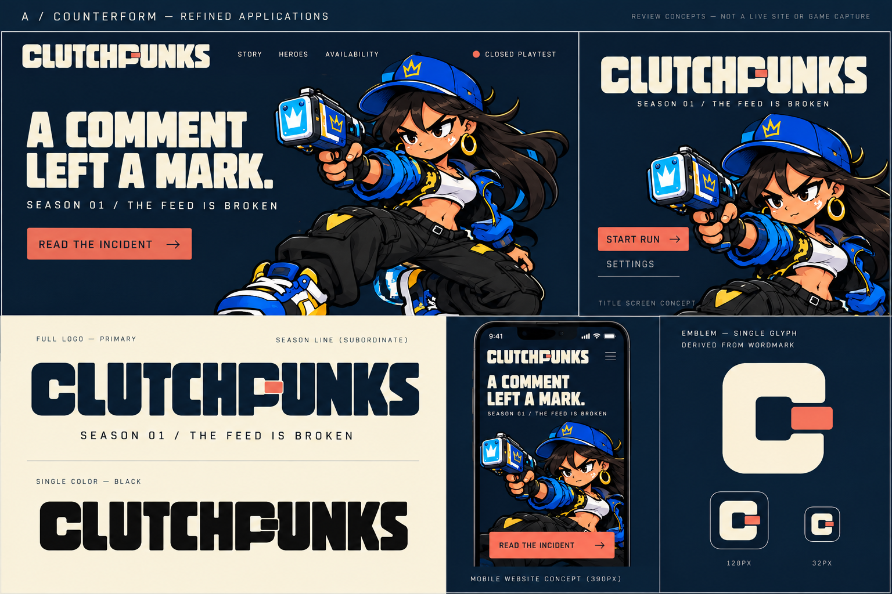

# Logo exploration — three different answers

**Status: review candidates, not approved assets.** Visual boards are raster explorations made with the built-in image-generation tool. They are not font files or editable vector masters. Exact prompts and file hashes accompany the boards. No existing franchise logo or platform mark was supplied as a reference.

## A / COUNTERFORM — recommended

**Idea:** The Feed tries to compress everyone into a prescribed shape. The opening in the mark refuses to close. Pressure, rather than technological decoration, becomes the permanent franchise device.

**Wordmark:** One compact horizontal CLUTCHPUNKS silhouette. Upright, broad, low-center-of-gravity custom letters. Square-round counters and controlled concave shoulders make it physical and cartoon-compatible. The C/P relationship supplies the emblem. One projecting tab is the disruption; repeated cuts on every letter would weaken it.

**Emblem:** An open counter derived from C/P, with a small displaced tab. It must not become a generic power icon or chat bubble. Rebuild the board's emblem with a visible opening at small sizes; do not approve a sealed blob.

**Palette and personality:** Cream and ink carry the whole design. Coral is a single intervention, never mandatory for recognition. Stubborn, assured and playful rather than angry. This sits beside large cartoon silhouettes without competing with their costume colors.

**Ownable design hypothesis:** A repeatable relationship between counter, shoulder and tab can extend from wordmark to layout. This is a design rationale, not evidence that no similar mark exists.

**Risk:** Broad geometric lettering can still feel like a technology brand. Preserve the weight and character of the letters; reject perfectly uniform modular construction and generic CP monograms. Inspect the final H/P junction and both U counters before selection.

## B / THE HOLDOUT — belonging without a team badge

**Idea:** A small crew occupies a space that the system wants to clear. The letters brace one another like a collective signature.

**Wordmark:** Two tightly coupled rows, CLUTCH above PUNKS, with unequal widths locked into one silhouette. Soft-ended, hand-drawn heavy letterforms, no distressed font or spraypaint. A long shared edge links the rows without putting them inside a shield.

**Emblem:** A compact abstract wedge held between two opposing curved brackets. It is a structural fragment of the lockup, not a fist, skull, crown or sports crest.

**Palette and personality:** Ink and paper; optional sky-blue footing. Warm, communal, irreverent. It emphasizes the protagonists over the machinery of The Feed.

**Ownable design hypothesis:** The interlocked two-row footprint can become an in-world crew stamp. The exact relationship of the two rows matters more than any texture.

**Risk:** The split can be read as two brands; test a five-second reading with unfamiliar readers. It is less efficient in a short website masthead. Never turn six appearance choices into a fictional six-person team to justify this route.

## C / RIGHT OF REPLY — an interruption with intent

**Idea:** An official statement is interrupted by a response that cannot be edited out. Typography becomes a contested document, not a broken video filter.

**Wordmark:** Narrow custom upright lettering, one coherent word, with a deliberate horizontal interruption confined to the middle join. A short offset reply stroke completes the silhouette. The missing segment cannot cross every letter or obstruct the name.

**Emblem:** Two unequal editorial bars and one open right-angle return, borrowed from the wordmark's cut. Avoid pause/play controls and platform reply-arrow conventions.

**Palette and personality:** Predominantly black/cream with one gold insertion. Dry, clever, investigative. Best at building the Chapter 00 mystery.

**Ownable design hypothesis:** A consistent editorial intervention offers a season-flexible visual grammar. It must remain readable as a game brand when the surrounding dossier is removed.

**Risk:** Too clinical for the actual cartoon game; the least strong recommendation for the permanent mark. Use the editorial structure in story layouts even if A wins, but do not mix the three wordmarks.

## Application contract

| Application | A / Counterform | B / Holdout | C / Right of Reply |
| --- | --- | --- | --- |
| Title screen | Broad centered or offset wordmark above live menu | Strong stacked poster anchor | Wide editorial strip; character art supplies warmth |
| Website masthead | Horizontal; emblem only in tight navigation | Compact stack; taller navigation requirement | Horizontal, excellent space efficiency |
| Avatar | Open-counter emblem | Braced wedge | Reply-stroke emblem |
| Season art | Season line below; mark stays constant | Season label beside, never inside lettering | Season line outside interruption |
| Small sizes | Remove optional coral; retain opening | Emblem preferred below full-name minimum | Remove cut detail before it harms legibility |

## Refined A proof and approval rules

Keep the franchise mark independent of “SEASON 01 / THE FEED IS BROKEN.” Align the season line to its left edge; gap at least half the logo cap height. The subtitle should occupy no more than one third of the wordmark's height. Omit chapter labels in the smallest lockup.

**Proposed geometry for reconstruction:** use cap height H as the unit; primary stems approximately 0.18H, counters at least 0.18H, smallest opening at least 0.12H, outside clear space at least 0.5H. Optical corrections take precedence over mechanical uniformity. These are starting constraints for the letter artist, not measurements claimed from the raster.

**Mono:** union all fills into one silhouette while preserving negative space; use solid ink on paper and solid paper on ink. No outline, shadow or coral is needed. Do not convert the entire board to grayscale and call that a master.

**Size targets, not yet certified:** full name at 240 px width and above; emblem at 32/48/64 px; simplify to a separately drawn micro-emblem at 16 px if required. Title applications at 1600×900 and 844×390; website at 1440×900 and 390×844. Review at native size, not only zoomed in. Confirm spelling and recognition before lowering the minimum. The board's miniature illustrations do not substitute for exported pixel-grid tests.

**Gate:** approve the direction → draw original editable curves → compare optical spacing and mono exports → test with exact approved hero art → record exact export/master hashes → creator accepts bytes. Do not auto-trace an imperfect generated wordmark and declare production complete.

## Originality self-review

Reject any candidate whose main identifying feature is a shield, bolt, generic graffiti outline, slant, chromatic split, stock distressed font or glow. Remove decoration and ask whether the core letterforms still distinguish it. Check C/G, U/V, H/N and P/R ambiguity. Keep no more than one dominant interruption. Compare logo-only silhouettes before admiring application polish.

No web collision audit or trademark clearance is included in this design package. Commission that review for the selected exact mark before public migration; do not mistake “original brief” for legal exclusivity.
