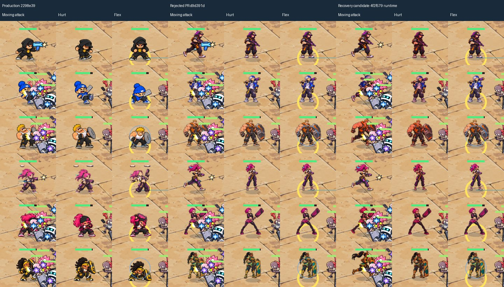

# PR #132 — hero motion recovery review

**Latest follow-up:** [recovery-facing and attachment verification](followup-report.md),
runtime `908392f3ce5fb14054da9c4b22ecb0e4147fe49d`. The report below describes the
earlier recovery. [Exact CPK application remains blocked](cpk-application-spec.md).

**Draft. Partial engineering recovery, not visual completion or creator acceptance.**
No merge, production deployment, replacement artwork or gameplay change is included.
The remaining idle/run transitions and authored attack/hurt/Flex actions prevent a
claim of premium animation or parity with production game feel.

## Source and evidence

| Reference | Exact source |
| --- | --- |
| Deployed production | `2298e39ab727a88defd7c421f95969f30a422212` |
| Rejected PR #132 | `d9d391db61e5f5e81a750a61c0066b7d29a8c720` |
| Dependency #125 | `b5ec5979eac7ad24ac4af461972caaaa537be27a` |
| Runtime corrections | `4f2f57983994170e41606d501670a343f0cf02a8` |
| Updated identity regression contracts | `a12f0a388935aed98fe1874efeb5300beeef1149` |

Production was identified from Vercel deployment `dpl_AUuHGV1N64drdcbBhHu6FWs9HJcK`,
then independently confirmed by its served `/build.json` (HTTP 200, commit above,
engine 4.7.2). Its matching `main` SHA was not assumed to identify production.
The remote #132 and #125 heads were inspected before editing. Later commits in
this recovery change tests, evidence and documentation only; runtime scripts,
project settings and assets match the runtime correction SHA above exactly.

The two creator recordings named in the request were not attached in this chat.
Comparison therefore uses the exact rejected source revision, not an assertion
that the original recordings were watched.



Columns: production, rejected #132, recovery. Within each: moving attack, hurt,
Flex. Rows: Sigma, Cool Kid, Alpha Chad, Pixel Vixen, Byte Baddie, Block Queen.
These are native Compatibility-rendered crops at gameplay zoom, composed for
comparison. Durable stationary targets and explicit damage/Flex setup make this
an **animation fixture**, not an organic progression or difficulty measurement.

## Verified audit, ordered by visual impact

1. **Missing authored actions and transitions:** the approved package contains
   run cycles and standing portraits, without separate attack/hurt/Flex/defeat
   or run-to-rest sequences. Full limb choreography cannot be recovered by
   changing frame selection. Standing portraits remain the resting source;
   the silhouette transition into/out of running is still an artistic gap.
2. **Moving attacks were explicitly suppressed:** `solo_run.hero_pose()` cleared
   `attack` after the weapon observer decorated the pose. Attacks now keep their
   state and event phase while the gait advances independently.
3. **Moving damage replaced the gait with a standing image:** run-frame selection
   depended on the highest-priority state being `run`. Hurt now preserves actual
   locomotion underneath the reaction, as attacks and moving Flex do.
4. **Movement facing overrode combat aim:** the old adapter always replaced
   facing with travel direction when moving. Actual queued attack aim now owns
   the visible body/prop direction; a separate horizontal travel latch prevents
   vertical travel from inheriting unrelated target-facing flips. Canonical
   facing used by Flex is not written by the presentation observer.
5. **Collision sliding used requested heading:** phase was correctly based on
   actual displacement, but heading used input direction. Presentation heading
   now follows the displacement surviving the existing axis-separated collider.
6. **Sigma had two blasters:** both new ranged bodies already contain a blaster,
   but the original-only attachment rule added another prop. Both appearances
   now use their embedded blaster, preserving existing launch/impact accents.
7. **Hero floor contact was visually offset:** the shared shadow added `(3,5)`
   world units to a foot-pivoted body. Only the hero call compensates this to
   center contact at `(0,1)`; enemy shadows and collision remain unchanged.
8. **Distance playback itself was already correct:** the gait advances from
   actual travel/base speed, retains its phase across direction changes, and
   does not run against blocked input. It was retained and tested at 30/60/120 Hz
   rather than replacing simulation movement with animation smoothing.

No outdated Vixen body layer is drawn by the active motion adapter. All 48 run
poses and six portrait/source identities pass the existing provenance verifier.
Native captures and the single-adapter regression cover the Vixen overlap case.
Rendering results below do not establish a GPU bottleneck or device acceptance.

## Implementation and pair results

- `scripts/approved_hero_motion.gd`: separates locomotion frame selection from
  canonical state precedence; adds a small foot-anchored torso deformation and
  damage tint. A single textured polygon deforms the existing image during a
  reaction; it does not draw a second body or alter the source texture.
- `scripts/weapon_presentation.gd`: exposes anticipation/execution/recovery and
  a bounded recoil envelope from the already queued event's actual deadline.
  The held prop follows the body's presentation offset. Existing resolved-hit
  observers, misses, cancellation and damage effects remain authoritative.
- `scripts/solo_run.gd`: retains attack state, tracks actual travel heading and
  horizontal visual orientation, and corrects hero shadow contact.
- `scripts/weapon_attachments.gd` and its provenance manifest: remove Sigma's
  duplicate handheld prop. Only the attachment-code hash and usage description
  change in that manifest; no image or artwork source hash changes.
- Existing motion, weapon, native capture and render benchmark tests are extended.
  HUD/menu/results/roster tests now expect the integrated portrait adapter rather
  than legacy textures. The missing-art fixture now mocks the active adapter.

| Pair | Engineering result | Remaining visual limitation |
| --- | --- | --- |
| Sigma / Pixel Vixen | Restrained event-driven ranged recoil; attacks while running; aim/body/prop coordination; no duplicate blaster or Vixen body | Independent firing arms, vertical/backward views and natural rest transitions are not authored |
| Cool Kid / Byte Baddie | Stronger short melee torso follow-through over uninterrupted gait; actual first/second activation timing retained | Full keyboard swings, finisher, hurt and recovery poses are missing |
| Alpha Chad / Block Queen | Smaller horizontal brace with a grounded vertical response; existing shields and Flex timing retained | Shield stance, slam/countershock and recovery choreography are missing |

Reduced Motion disables the added torso displacement while retaining gait and
readable damage state. No movement easing or input delay is introduced. No RNG,
weapon interval, damage, collider, progression, spawn, save or kit code is changed.

## Rendered measurement

The same benchmark fixture runs sequentially on all three source versions:
Godot `4.7.2.stable.official.ed1daf0bf`, Linux Xorg, Compatibility renderer,
Mesa llvmpipe (LLVM 19.1.7, 256 bits), vsync unavailable/disabled, seed 451.
At each viewport it uses opening gameplay and synthetic starts with 25/90 normal
enemies, normal player HP, canonical attacks, changing directions and a final stop.
Each case has 30 warmup plus 180 measured rendered frames at fixed simulation
steps of 1/60 s. No browser, import, movie writer or test suite runs concurrently.

| Source | Viewport | Initial enemies | Interval p50 / p95 / p99 (ms) | Process p95 (µs) | Pose p95 (µs) |
| --- | --- | ---: | --- | ---: | ---: |
| production | 1280×720 | 0 | 21.94 / 49.22 / 52.73 | 616 | 59 |
| production | 1280×720 | 25 | 25.15 / 50.26 / 53.40 | 933 | 73 |
| production | 1280×720 | 90 | 39.88 / 66.39 / 113.59 | 2856 | 98 |
| production | 844×390 | 0 | 11.98 / 26.68 / 32.79 | 548 | 37 |
| production | 844×390 | 25 | 11.79 / 23.09 / 26.66 | 740 | 44 |
| production | 844×390 | 90 | 18.96 / 34.47 / 42.28 | 2401 | 28 |
| before | 1280×720 | 0 | 22.52 / 49.89 / 52.79 | 596 | 124 |
| before | 1280×720 | 25 | 25.53 / 49.13 / 50.36 | 993 | 57 |
| before | 1280×720 | 90 | 34.28 / 59.81 / 71.98 | 2427 | 65 |
| before | 844×390 | 0 | 9.84 / 26.08 / 31.11 | 534 | 77 |
| before | 844×390 | 25 | 11.61 / 23.82 / 27.28 | 854 | 55 |
| before | 844×390 | 90 | 17.09 / 24.62 / 48.07 | 2054 | 42 |
| revised | 1280×720 | 0 | 21.71 / 48.88 / 53.40 | 593 | 114 |
| revised | 1280×720 | 25 | 24.87 / 48.70 / 53.77 | 964 | 115 |
| revised | 1280×720 | 90 | 33.95 / 61.07 / 74.45 | 2318 | 93 |
| revised | 844×390 | 0 | 12.49 / 25.18 / 32.21 | 530 | 77 |
| revised | 844×390 | 25 | 13.67 / 25.99 / 65.70 | 1192 | 77 |
| revised | 844×390 | 90 | 18.04 / 27.09 / 46.53 | 2575 | 71 |

Raw data: [performance.json](performance.json).

The initial revised 844×390/25-enemy p99 spike (65.71 ms) prompted three
alternating isolated repetitions. Rejected/revised p95 values were
22.60/23.27, 24.89/25.04 and 26.78/24.75 ms; p99 values were
26.64/27.06, 87.99/29.70 and 44.09/52.06 ms. Both versions show intermittent
software-renderer/scheduler tails. These short runs do not demonstrate a
repeatable severe regression or establish real-device frame pacing. The
revised pose descriptor adds a few microseconds of median CPU work.
Reproduction: append `--mobile-regular` to the existing `--motion` runner.
The six focused repetitions used this committed runner, sequentially after
all other Godot/browser jobs finished.

These are native render-loop intervals measured with `frame_post_draw`, including
CPU submission, software rendering, scheduling and synchronization. They are
**not guaranteed display-presented frame times or GPU execution times**.
`process_cpu_us` measures the complete `_process` call, not isolated simulation;
`pose_cpu_us` measures descriptor construction, not the entire hero draw.
Raw results include final enemy/projectile/effect counts, mode and active time.
The dense fixture enters a real level-up choice at 3.25 active seconds in all
three versions; its final frames therefore include that menu. It is not a
sustained-dense-combat benchmark. Final counts and modes match across versions.

This cloud software renderer cannot certify a 16.7 ms desktop p95, physical-mobile
30–60 FPS, input-to-photon latency or perceived production parity. Movie output
at fixed 30 FPS is visual evidence, not a runtime FPS benchmark. No measured
performance improvement is claimed from the subjective presentation changes.

## Executed QA and reproduction

Engine archive SHA-256 was verified against the repository's pinned official
checksum. Export templates are the pinned official 4.7.2 templates. The image
initially supplied Godot 4.6.3; it was not used for the reported Godot checks.

**Required full script: FAIL** at `frame-pacing-state`. The same frozen
pre-optimization hash contract fails on the rejected `d9d391d` source with
Godot 4.7.2. Its checked-in golden hashes were deliberately not replaced.
Directly recorded normal/dense/Flex hashes from rejected and corrected sources
match exactly, and all other applicable checks were executed, including the
remaining script phases via a temporary continuation after this failure.

Earlier runs also found legacy portrait/HUD/roster expectations predating the
approved motion integration; those tests now exercise the active adapter and
pass. This report does **not** claim that `bash scripts/validate.sh` passes.
The inherited golden-state failure is a remaining mandatory-check blocker.
Across the full attempt plus the continued remaining phases, **82 of 83 Godot
phases passed**, with only this phase failing. The continuation runs the unchanged
remaining commands from `reconciled-floor-geometry` onward. See
[validation.json](validation.json) for exact state hashes and coverage.

Validation/build/capture commands below ran from the project root with the downloaded 4.7.2 executable
first in `PATH` (or its absolute path). Source worktrees were kept separate.

```sh
bash scripts/validate.sh
GODOT_BIN=/workspace/tools/godot-4.7.2/godot GODOT_SKIP_TEMPLATE_DOWNLOAD=1 bash scripts/build_web.sh
python3 scripts/verify_approved_motion.py
python3 scripts/verify_weapon_presence.py
# Focused engine tests:
godot --headless --path . --script tests/test_approved_hero_motion.gd
godot --headless --path . --script tests/test_locomotion_runtime.gd
godot --headless --path . --script tests/weapon_presence/test_contract.gd
godot --headless --path . --script tests/weapon_presence/test_parity.gd
# Record existing authoritative state hashes independently on both checkouts:
godot --headless --path . --script tests/frame_pacing/state_trace.gd -- --record /workspace/scratch/pr132-after-state.json
cmp /workspace/scratch/pr132-before-state.json /workspace/scratch/pr132-after-state.json
# Native matrix, repeated on production/rejected/recovery source:
DISPLAY=:99 godot --audio-driver Dummy --path . --script tests/capture_hero_presentation.gd -- /workspace/scratch/pr132-final-matrix --motion-review
# Same matrix was first reviewed for the ranged reference pair with --pair.
# Continuous six-appearance native gameplay movie:
DISPLAY=:99 godot --audio-driver Dummy --path . --fixed-fps 30 --write-movie /workspace/scratch/pr132-native.avi --script tests/record_approved_hero_motion.gd -- /workspace/scratch/pr132-native-poses.json
# Native performance helper smoke check (timings not used in the comparison):
DISPLAY=:99 godot --audio-driver Dummy --path . --script tests/review_render_performance.gd -- --motion /workspace/scratch/pr132-revised-perf.json
git diff --check
```

The recorded three-version measurement used an identical external copy of the new `--motion`
method on the two older checkouts, which lack that method. The exact measurement command was `DISPLAY=:99 godot --audio-driver Dummy --path <checkout> --script /workspace/scratch/motion_benchmark.gd -- <output.json>`. No gameplay code was
changed in either baseline. QA branch tools were inspected but not merged: the
existing motion recorder, disposable-profile combat fixtures and render benchmark
covered this focused comparison without importing QA hooks into the gameplay PR.
Synthetic matrix targets are stationary/durable; the normal native gameplay movie
and browser runs are distinct. The 24-second movie has 720 rendered frames and all
six identities; its temporary AVI was converted to MP4 and removed.

Exact normal/dense/Flex state hashes match the rejected source. The existing
weapon parity runner passes 3,456 exact per-frame comparisons across nine weapons,
both appearances and common/legendary equipment. Extended coverage includes
blocked motion, actual collision-slide heading, variable update rates, vertical
facing, attacks while moving/stationary, windup/execution/recovery, hurt/Flex gait,
Reduced Motion, selection, Retry, import, saves and fail-closed missing assets.

Chromium/SwiftShader ran the actual exported Web build through all six appearance
selections, real keyboard movement/reversal and pause/resume: zero page/console
errors. An 844×390 touch-enabled browser also started gameplay and used actual
CDP touch input for the joystick. These are desktop browser viewport checks,
not physical-mobile measurements. Level-up/progression contracts passed in
Godot tests; an organic browser level-up was not part of this short Web review.

An initial shared import cache contaminated the legacy Vixen texture readback.
The caches were separated and that texture reimported before final tests and
measurements. Initial contaminated captures/measurements were discarded.

## Preview, remaining gate and next steps

The existing #132 branch will provide the protected Vercel review deployment;
its final URL and served source SHA are recorded in the PR update. No production
deployment is requested or performed.

The local export's `build.json` identifies runtime commit `4f2f57983994170e41606d501670a343f0cf02a8`
and engine 4.7.2. Subsequent commits contain only test/evidence/documentation
changes; no test fixtures or raw source masters are included in the Web export.
Hosted deployment source verification is recorded in the PR update.

See [the unapproved pose brief](art-dependencies.md). The standing/run silhouette
change, fully authored attacks, hurt, Flex and defeat remain unresolved. Small
procedural reactions do not establish visual completion. Creator visual acceptance,
real-device pacing and a convincing production game-feel comparison remain open.

1. Creator reviews the partial recovery preview and the exact missing-pose brief.
2. The art pipeline supplies and obtains explicit acceptance of the listed action
   and transition candidates, retaining the immutable approved masters.
3. Integrate accepted poses and repeat native/Web comparison and real-device
   pacing review before any final artistic acceptance or merge decision.
