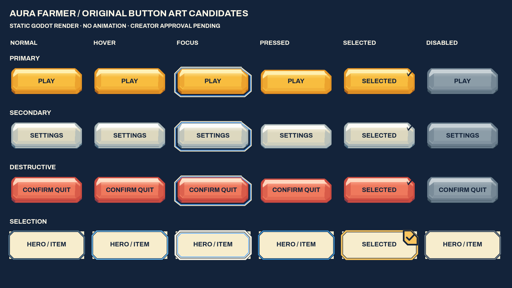
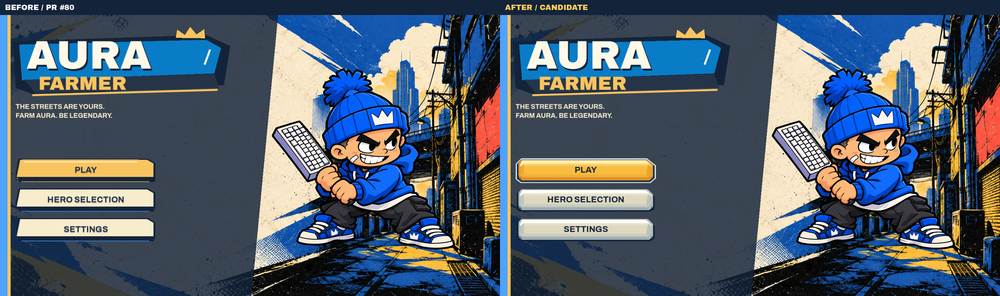

# M0 button art — creator review candidate

Original static artwork integrated into the actual game. **Art approval pending; do not merge automatically.**

This Draft is stacked on PR #80 (`fix/m0-hud-hero-quit-feedback`, `9f3cc26b27a8a9c1b5f8cd2cdbbd946e92683836`). At audit, main was `201127a6377f2a8d557d5edc51b63e4f426e2273` and #80 was open/Draft. Its Quit, hero identity, Shield and Flex fixes are deliberately retained. No historical #80 evidence is replaced.

## Review images

[All 24 static states](evidence/components.png) · [Menu before/after](evidence/compare-hero-menu-1600x900.jpg) · [Pause before/after](evidence/compare-paused-1600x900.jpg) · [Quit confirmation](evidence/compare-confirm-exit-844x390.jpg) · [Hero selection](evidence/compare-hero-selection-844x390.jpg) · [Three-card upgrade](evidence/compare-choice-selected-915x412.jpg) · [Portrait legendary selection](evidence/compare-legendary-selected-390x844.jpg)





The baseline used the same deterministic fixture script on the unmodified #80 HEAD. The old face depended on separately drawn lines/shadows; the new PNG face contains its full material construction before animation. Frames are actual Godot 4.7.2 Compatibility renders, Mesa llvmpipe, with Reduced Motion enabled. They are automated native fixtures, **not browser or physical-device gameplay evidence**. Captures use seed 801 and an isolated in-memory default profile; saving is overridden. Full-resolution delivery JPEGs are unretouched PNG transcodes (quality 94, no chroma subsampling); comparison labels are outside the captured frames. [Capture manifest](evidence/capture-manifest.json) records original PNG and delivered JPEG hashes.

## Components and provenance

| Family | Construction | Runtime use |
| --- | --- | --- |
| Primary | Broad gold face, warm cut shoulders, stepped lower shell | Play, Start Run, Confirm |
| Secondary | Cream face, cool blue-grey frame and lower shell | Settings, Return, Resume, navigation |
| Destructive | Coral face, dark warm lower shell, explicit original label | Quit Run and final Confirm Quit |
| Selection | Transparent frame with angular gold check tab | Hero and upgrade selection; approved portraits and icons remain visible |

All four families have separate normal, hover, focus, pressed, selected and disabled PNGs. Focus uses a cream/blue contour; disabled faces are desaturated. Selection remains explicit through both its check tab and existing SELECTED text. The selected state takes priority over hover/focus on already-selected cards. Generic action selected variants are provided for reuse; current momentary actions do not become toggles.

Artwork is newly authored original SVG geometry by OpenAI Codex for this creator-directed repository task; no third-party artwork, embedded images, fonts or traced assets. Editable sources and exact SHA-256 provenance are in `assets/ui-button-candidates/v1/source/` and `manifest.json`. `build_sources.py` reproduces SVGs; `rasterize.gd` uses Godot's SVG renderer at 2× to produce transparent RGBA PNGs (1024×192 action / 512×512 selection). No external raster library or AI-generated mockup is used as runtime evidence.

Typography remains the existing Archivo Black / Archivo hierarchy and packaged SIL OFL licenses. No new font, gameplay rule, profile field, renderer, character, enemy, environment or icon was introduced. Gold/cream/navy/coral choices and sculpted shoulders are design judgments for the requested arcade direction, not claims that they reproduce another game's design. Brawl Stars' official [logo redesign explanation](https://supercell.com/en/games/brawlstars/blog/news/brawl-stars-logo-is-changing/) supports recognizable hierarchy and reduced complexity; [Whiteout Survival](https://whiteoutsurvival.centurygames.com/) is a creator-named visual reference, not an asset source or a measured implementation benchmark.

## Runtime architecture and boundaries

`hero_clash_button_art.gd` preloads 24 PNGs and caches each nine-slice StyleBoxTexture once. Rendering scales the source pixel density vertically before horizontal stretching so short controls retain their authored cap proportions. The existing single `ClashButtonFeedback` child draws the face and live Button label; it ignores input and never replaces callbacks, focus ownership or hit rectangles. Native menu backgrounds are empty to prevent old artwork bleeding through. Cards retain category-specific approved idle backing beneath a transparent candidate selected frame, avoiding duplicate check marks. No recurring image generation or per-frame resource allocation occurs.

Existing short press travel and Reduced Motion semantics remain. No new glow, particle, pulse or transition phase was added. The static faces provide the depth. Main Menu, Pause, Quit, hero selection, three-card and six-card choices use the shared system. Candidate PNGs are included only in this review branch's build; SVG sources and all review fixtures/evidence are excluded from exports. They are not added to an approved art registry.

Explicit creator approval would be required before promoting this replacement of the visible `assets/runtime-clean-cut/v2/menu/primary-{default,hover,focus,pressed,disabled}.png` and `secondary-{default,hover,focus,pressed,disabled}.png` treatments, and selected-frame presentation for `hero-select/card-selected.png`, `cards/{weapon,passive}-selected.png`, and `cards/legendary[-mobile]-{weapon,passive}-selected.png`. **All those original resources and recorded hashes remain unchanged.** No wordmark supersession is proposed here.

## Reproduction and validation

```
python3 tests/button_art/build_sources.py
godot --headless --path . --script res://tests/button_art/rasterize.gd
godot --headless --path . --editor --import --quit
python3 scripts/verify_button_candidates.py
bash scripts/validate.sh
godot --path . --script res://tests/button_art/gallery.gd -- /absolute/output/components.png
godot --path . --script res://tests/button_art/capture.gd -- 1600 900 /absolute/output
bash scripts/build_web.sh
```

Run capture for all six dimensions below. Full-resolution before/after files are linked in the matrix. Portrait six-card offers retain the existing scroll container and fixed confirmation footer: all six remain accessible rather than being compressed into one screen. Small text in existing card descriptions is unchanged; physical-device reading comfort still requires creator testing. Native pointer regression checks real press/held/release navigation, preserved hit rectangles and the two-step Quit flow at all six sizes. Existing keyboard, touch, Flex, Shield, profile and gameplay regression checks remain in the full suite. Two old tests that explicitly required the previous texture paths now verify the candidate renderer and category-aware backing instead; their behavioral assertions remain.

Web export uses checksum-verified official Godot 4.7.2 and templates. PCK inspection verifies 37 approved icons, 84 Clean Cut resources, 19 original masters, existing font licenses, all 24 new imported PNGs and the candidate manifest, and exclusion of editable SVGs. Native captures/export success do not establish WebGL2 browser or physical-touch validation. Final artistic acceptance remains the creator's decision.

Measured Play hit target (actual root canvas transform): 540×96 at 1920×1080, 450×80 at 1600×900, 360×64 at 1280×720, approximately 270×48 at both landscape mobile sizes and portrait. Its rendered label is 33, 27.5, 22, 16.47, 16.5 and 14.24 physical pixels respectively. These are measurements of the preserved existing responsive pipeline, not universal device requirements. Portrait remains the weakest text-size case and needs a physical-device comfort review; this button-art pass does not hide that limitation.

## Full-resolution capture matrix

| Viewport | Menu | Pause | Quit | Heroes | Upgrades | Legendary |
| --- | --- | --- | --- | --- | --- | --- |
| 1920x1080 | [before](evidence/before/m0-hero-menu-1920x1080.jpg) / [after](evidence/after/m0-hero-menu-1920x1080.jpg) | [before](evidence/before/m0-paused-1920x1080.jpg) / [after](evidence/after/m0-paused-1920x1080.jpg) | [before](evidence/before/m0-confirm-exit-1920x1080.jpg) / [after](evidence/after/m0-confirm-exit-1920x1080.jpg) | [before](evidence/before/m0-hero-selection-1920x1080.jpg) / [after](evidence/after/m0-hero-selection-1920x1080.jpg) | [before](evidence/before/m0-choice-selected-1920x1080.jpg) / [after](evidence/after/m0-choice-selected-1920x1080.jpg) | [before](evidence/before/m0-legendary-selected-1920x1080.jpg) / [after](evidence/after/m0-legendary-selected-1920x1080.jpg) |
| 1600x900 | [before](evidence/before/m0-hero-menu-1600x900.jpg) / [after](evidence/after/m0-hero-menu-1600x900.jpg) | [before](evidence/before/m0-paused-1600x900.jpg) / [after](evidence/after/m0-paused-1600x900.jpg) | [before](evidence/before/m0-confirm-exit-1600x900.jpg) / [after](evidence/after/m0-confirm-exit-1600x900.jpg) | [before](evidence/before/m0-hero-selection-1600x900.jpg) / [after](evidence/after/m0-hero-selection-1600x900.jpg) | [before](evidence/before/m0-choice-selected-1600x900.jpg) / [after](evidence/after/m0-choice-selected-1600x900.jpg) | [before](evidence/before/m0-legendary-selected-1600x900.jpg) / [after](evidence/after/m0-legendary-selected-1600x900.jpg) |
| 1280x720 | [before](evidence/before/m0-hero-menu-1280x720.jpg) / [after](evidence/after/m0-hero-menu-1280x720.jpg) | [before](evidence/before/m0-paused-1280x720.jpg) / [after](evidence/after/m0-paused-1280x720.jpg) | [before](evidence/before/m0-confirm-exit-1280x720.jpg) / [after](evidence/after/m0-confirm-exit-1280x720.jpg) | [before](evidence/before/m0-hero-selection-1280x720.jpg) / [after](evidence/after/m0-hero-selection-1280x720.jpg) | [before](evidence/before/m0-choice-selected-1280x720.jpg) / [after](evidence/after/m0-choice-selected-1280x720.jpg) | [before](evidence/before/m0-legendary-selected-1280x720.jpg) / [after](evidence/after/m0-legendary-selected-1280x720.jpg) |
| 915x412 | [before](evidence/before/m0-hero-menu-915x412.jpg) / [after](evidence/after/m0-hero-menu-915x412.jpg) | [before](evidence/before/m0-paused-915x412.jpg) / [after](evidence/after/m0-paused-915x412.jpg) | [before](evidence/before/m0-confirm-exit-915x412.jpg) / [after](evidence/after/m0-confirm-exit-915x412.jpg) | [before](evidence/before/m0-hero-selection-915x412.jpg) / [after](evidence/after/m0-hero-selection-915x412.jpg) | [before](evidence/before/m0-choice-selected-915x412.jpg) / [after](evidence/after/m0-choice-selected-915x412.jpg) | [before](evidence/before/m0-legendary-selected-915x412.jpg) / [after](evidence/after/m0-legendary-selected-915x412.jpg) |
| 844x390 | [before](evidence/before/m0-hero-menu-844x390.jpg) / [after](evidence/after/m0-hero-menu-844x390.jpg) | [before](evidence/before/m0-paused-844x390.jpg) / [after](evidence/after/m0-paused-844x390.jpg) | [before](evidence/before/m0-confirm-exit-844x390.jpg) / [after](evidence/after/m0-confirm-exit-844x390.jpg) | [before](evidence/before/m0-hero-selection-844x390.jpg) / [after](evidence/after/m0-hero-selection-844x390.jpg) | [before](evidence/before/m0-choice-selected-844x390.jpg) / [after](evidence/after/m0-choice-selected-844x390.jpg) | [before](evidence/before/m0-legendary-selected-844x390.jpg) / [after](evidence/after/m0-legendary-selected-844x390.jpg) |
| 390x844 | [before](evidence/before/m0-hero-menu-390x844.jpg) / [after](evidence/after/m0-hero-menu-390x844.jpg) | [before](evidence/before/m0-paused-390x844.jpg) / [after](evidence/after/m0-paused-390x844.jpg) | [before](evidence/before/m0-confirm-exit-390x844.jpg) / [after](evidence/after/m0-confirm-exit-390x844.jpg) | [before](evidence/before/m0-hero-selection-390x844.jpg) / [after](evidence/after/m0-hero-selection-390x844.jpg) | [before](evidence/before/m0-choice-selected-390x844.jpg) / [after](evidence/after/m0-choice-selected-390x844.jpg) | [before](evidence/before/m0-legendary-selected-390x844.jpg) / [after](evidence/after/m0-legendary-selected-390x844.jpg) |
