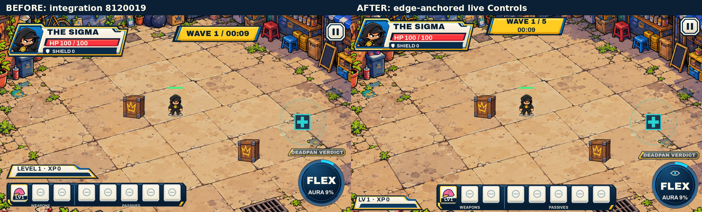

# Edge-anchored gameplay HUD review

Baseline: integration `812001968dd108eae8e76d99c4d915d02e9fe7ba` on `fix/m0-navigation-ui-recovery` (#82), including merged #86/#87. This is a layout/presentation candidate. Creator visual acceptance and merge remain pending.

[Before / after](evidence/before-after.jpg) · [Normal / boss](evidence/normal-boss.jpg) · [Gameplay video](evidence/gameplay.mp4) · [Validation](evidence/validation.json) · [Targeted checks](evidence/targeted-checks.json)

Seven independently anchored live Controls share the existing usable-viewport/safe-area transform. Hero status is 4 logical units from top/left; wave/time uses the actual horizontal center; Pause is 4 units from top/right. Boss status sits immediately left of Pause when it fits, or directly below the upper modules at the right edge. Its original Big Hater portrait, current/max HP and phase use real state; no boss panel remains outside encounters.

XP anchors bottom-left, exactly three weapons plus five passives share one bottom-centered rail, and the circular Flex anchors bottom-right. The 6-unit Flex inset contains the existing READY-ring expansion. Portrait and constrained windows put the full equipment rail on the bottom edge with XP and Flex directly above it. Portrait uses a second centered top row for wave/time because a full hero module, centered wave and Pause cannot fit side by side. No essential equipment information is hidden to fit that fallback.

All names, HP/shield, XP, levels, Aura and encounter clocks remain live. Short status tints observe actual damage/healing/shield changes; critical HP stays legible without motion. The existing circular dial gains simple original eye/ENTER/shield UI motifs for the three canonical Flex identities. Their names and lifecycle remain unchanged. Full item details stay in the existing build inspection. Passive HUD Controls ignore input, so their underlying terrain remains eligible for the floating joystick.

Pause now shows one centered panel over a dimmed, frozen arena. The existing Resume / Your Build / Settings / Quit actions and confirmation ownership are retained. Gameplay HUD controls hide while paused. No additional modal, invisible duplicate action or input-intercepting decoration was added.

| Actual native capture | Desktop | Mobile / constrained |
| --- | --- | --- |
| Normal gameplay | [1920×1080](evidence/start-1920x1080.jpg), [1600×900](evidence/start-1600x900.jpg), [1280×720](evidence/start-1280x720.jpg) | [915×412 with floating joystick](evidence/mobile-touch-915x412.jpg), [844×390 with asymmetric safe area](evidence/mobile-touch-844x390.jpg) |
| Boss / telegraph | [1600×900](evidence/boss-1600x900.jpg), [1280×720](evidence/boss-1280x720.jpg) | [915×412](evidence/boss-915x412.jpg), [844×390](evidence/boss-844x390.jpg), [390×844](evidence/boss-390x844.jpg) |
| Full 3+5 equipment | [1600×900](evidence/full-build-1600x900.jpg) | [390×844 portrait fallback](evidence/full-build-390x844.jpg) |
| Flex states | [READY](evidence/ready-1600x900.jpg), [active](evidence/active-1600x900.jpg), [Berserk](evidence/berserk-1600x900.jpg) | Actual Aura/state bindings and independent second finger covered by the existing touch tests |
| Pause | [1600×900](evidence/paused-1600x900.jpg) | [844×390](evidence/paused-844x390.jpg) |

Evidence is real Godot 4.7.2 Compatibility/X11 software rendering. Still images use canonical fixture data; the ~9-second video runs the real simulation with scripted keyboard events, actual damage/pickups/camera and pause/resume. It is not human play, browser/device validation or a performance benchmark. The 844×390 native window reads back at 843×390. Safe-area values are synthetic CSS insets, not an invented phone measurement. Partial capture reports describe only the states recorded in each report.

Observed compact label sizes include 15 physical px for HP/XP, 13.5 for shield/item levels/boss HP, and 12 for the secondary boss phase. These are this renderer's scaled sizes, not universal accessibility thresholds or physical-phone acceptance. The original Pixel 8a / Brave frame-pacing verification remains pending and is not resolved by a HUD rearrangement.

Targeted checks cover all three heroes, six canonical viewports plus asymmetric-safe-area resizing, edge/center constraints, peer overlaps, original portrait/icon identity, live boss/phase data, damage/heal/shield/critical feedback, complete equipment, real held-pointer Pause/Quit, unchanged drag cache, full-playfield floating joystick and independent second-finger Flex. The existing irregular-frame simulation/RNG/camera hashes remain identical. Full mandatory CI and Web export run on the PR revision; their results belong to the PR checks. Approved masters, 37 icons, 84 Clean Cut resources, candidate artwork bytes, fonts/licenses, rules, profile compatibility, fullscreen and DPR handling are untouched.

Changed implementation/test files:

- `scripts/hero_clash_hud.gd`: anchored modules, responsive layout, live boss/clock and bounded status feedback.
- `scripts/clean_cut_skin.gd`: preserve module parenting and route the existing Pause heading.
- `scripts/clean_cut_secondary.gd`: centered Pause panel and reusable dim surface.
- `scripts/hero_clash_flex_dial.gd`: lightweight hero-specific motifs on the existing circular dial.
- `tests/hud_v2/test_hud.gd`, `tests/test_flex_readability.gd`, `tests/recovery_m01/layout_audit.gd`: meaningful geometry/state/input regressions and intended nested phase treatment.
- `tests/hud_v2/capture.gd`, `tests/hud_edges/record.gd`: reproducible native capture paths with save-isolated review profiles.
- `.github/workflows/godot-ci.yml`: allow full validation for this Draft branch; no new deployment trigger.

Reproduce stills with a native display: `godot --path . --rendering-driver opengl3 --script res://tests/hud_v2/capture.gd -- 1600 900 /tmp/hud-review --edge-review`. Use the other canonical extents; add `--safe-area` for the 844×390 inset example. `--states=paused` or `--states=boss,berserk` restricts captures and writes a separate report. Evidence directories are ignored by Godot and remain outside Web exports. No approved artwork file or art approval register was overwritten or promoted.
