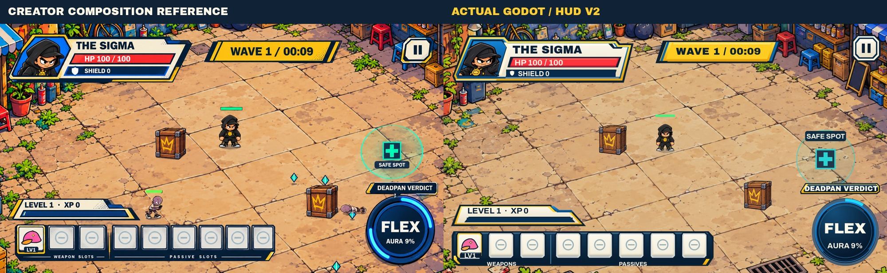

# Hero Clash Gameplay HUD V2 — creator review

Implemented in `ui/hero-clash-gameplay-hud-v2`, stacked on PR #82 at `499baf14c28b4b3124660f47217e37495ca0be52`. PRs #80–82 remained open Draft at the initial and final integration audit. No merge, release, approved-asset promotion or gameplay retuning is authorized.

[Desktop before/after](evidence/before-after-1600x900.jpg) · [Mobile landscape before/after](evidence/before-after-844x390.jpg) · [Portrait before/after](evidence/before-after-390x844.jpg) · [Actual component states](evidence/component-states.jpg) · [30-second native recording](evidence/native-normal-health-30s.mp4)

These are real Godot 4.7.2 Compatibility renders. Screenshots are explicitly staged state fixtures, not a played run. Comparisons only resize/crop actual outputs and add review labels outside them. [Capture provenance and PNG hashes](evidence/capture-manifest.json). CI retains its original-resolution PNG matrix as an artifact.

## Visual comparison and controlled adaptations

| Component | Reference target | Actual implementation / evidence | Discrepancy and review status |
| --- | --- | --- | --- |
| Overall hierarchy | Player upper left, Wave above center, Pause right, progression/equipment below left, Flex below right | [Start / 1600](evidence/after/start-1600x900.jpg) | Implemented; creator visual review pending |
| Player silhouette | Cream/navy angular plate, blue/gold accents, prominent portrait | [All original heroes](evidence/after/alpha-1600x900.jpg) | Approved master portraits cropped by shader, never replaced with the mockup's alternative depiction |
| HP / Shield | Red HP and independent blue Shield inside one frame | [Shield](evidence/after/shield-1600x900.jpg), [partial](evidence/after/partial-1600x900.jpg), [low](evidence/after/low-hp-1600x900.jpg) | Real values; Shield remains shield/max HP, preserving the existing normalization and 40% gameplay cap |
| Wave / Pause | Gold angular banner and matching cream Pause | [Focus](evidence/after/pause-focus-1600x900.jpg), [pressed](evidence/after/pause-pressed-1600x900.jpg) | Actual existing Button, authored normal/hover/focus/pressed/disabled faces; no new callbacks |
| Boss / warnings | Reserve additional encounter information | [Boss / 1600](evidence/after/boss-1600x900.jpg) | Added reserved row below the top modules, absent from the illustrative reference |
| Level / XP | Compact cream title, real blue progress directly below | [Midgame](evidence/after/midgame-1600x900.jpg) | Editable values and true level threshold; no baked sample fill |
| Equipment | One navy support, clear light icon wells, levels, secondary group labels | [Full 3+5 build](evidence/after/full-build-1600x900.jpg) | Exactly eight slots; illustrative extra positions are not reproduced. Exact approved icons, no permanent long names; full identity/stats remain in Build |
| Flex / ability | Circular blue material, separate angular nameplate | [9%](evidence/after/start-1600x900.jpg), [READY](evidence/after/ready-1600x900.jpg), [active](evidence/after/active-1600x900.jpg), [recovery](evidence/after/recovery-1600x900.jpg) | Actual charge arc, rather than the reference's illustrative bright arc; gold READY/halo, existing entry/press animation and Reduced Motion |
| Safe Spot | Restrained turquoise station and compact label | [Near controls](evidence/after/safe-near-ui-1600x900.jpg) | World point (1100,565), 68 U radius and mechanics stay fixed. Label tries four offsets, yielding to HUD/encounter/legendary controls; if none fit, the ring/plus remain while the label yields |
| Type / spacing | Bold arcade headings and clean numeric hierarchy | [Small landscape](evidence/after/start-844x390.jpg), [portrait](evidence/after/start-390x844.jpg) | Existing locally licensed Archivo Black/Archivo. Native desktop and mobile layout sizes differ intentionally; no synthetic skew or thick universal text outline |

The original environment, actor scale, enemies, cover, icons and gameplay camera remain unchanged. World content can naturally pass behind opaque screen-edge HUD; the label priority does not relocate the station or actors. Dense-action readability and physical-phone comfort still require creator/device review.

## Six-viewport evidence

Each link below opens a real capture at its stated pixel extent. The [after directory](evidence/after) contains all 16 states at all six extents: start/full HP, partial HP, shield, low HP, midgame, full build, READY, active, recovery, boss, Safe Spot near UI, Cool Kid, Alpha, Pause focus, Pause pressed and paused. The [before directory](evidence/before) contains equivalent start/full-build/READY/boss fixtures at 1600×900, 844×390 and 390×844.

| Viewport | Start / HUD | Full inventory | READY | Boss |
| --- | --- | --- | --- | --- |
| 1920×1080 | [HUD](evidence/after/start-1920x1080.jpg) | [3+5](evidence/after/full-build-1920x1080.jpg) | [READY](evidence/after/ready-1920x1080.jpg) | [Boss](evidence/after/boss-1920x1080.jpg) |
| 1600×900 | [HUD](evidence/after/start-1600x900.jpg) | [3+5](evidence/after/full-build-1600x900.jpg) | [READY](evidence/after/ready-1600x900.jpg) | [Boss](evidence/after/boss-1600x900.jpg) |
| 1280×720 | [HUD](evidence/after/start-1280x720.jpg) | [3+5](evidence/after/full-build-1280x720.jpg) | [READY](evidence/after/ready-1280x720.jpg) | [Boss](evidence/after/boss-1280x720.jpg) |
| 915×412 | [HUD](evidence/after/start-915x412.jpg) | [3+5](evidence/after/full-build-915x412.jpg) | [READY](evidence/after/ready-915x412.jpg) | [Boss](evidence/after/boss-915x412.jpg) |
| 844×390 | [HUD](evidence/after/start-844x390.jpg) | [3+5](evidence/after/full-build-844x390.jpg) | [READY](evidence/after/ready-844x390.jpg) | [Boss](evidence/after/boss-844x390.jpg) |
| 390×844 | [HUD](evidence/after/start-390x844.jpg) | [3+5 fallback](evidence/after/full-build-390x844.jpg) | [READY](evidence/after/ready-390x844.jpg) | [Boss](evidence/after/boss-390x844.jpg) |

Landscape keeps one equipment row. Portrait uses a weapon row plus passive row, with Flex above progression. Layout uses the #82 CSS extent/safe-area adapter and retains its capped mobile raster. At native 844×390, essential numeric text uses approximately 13.5–17.25 physical pixels, the Pause target is 54×51 and Flex is 123×123; secondary group labels are smaller. These are measured pipeline sizes, **not proof of comfortable physical-device readability**. JSON files beside the screenshots record actual Control rectangles and physical font sizes.

## Components / provenance / supersession

- [HUD presenter](../../scripts/hero_clash_hud.gd): geometry cache and live data bindings; no simulation/RNG/profile ownership.
- [Clipped meter](../../scripts/hero_clash_hud_meter.gd): cached full-width authored face, clipped by actual progress.
- Existing actual Flex/Pause Buttons retain their original callbacks and touch routing. Artwork is input-transparent.
- [Twenty editable original SVGs and portrait shader manifest](../../assets/ui-hud-candidates/v2/manifest.json): source/runtime identifiers, dimensions, transparency, hashes and pending approval. [Reproducible source generator](../../assets/ui-hud-candidates/v2/source/build_assets.py). No third-party art, mockup pixels, text outlines or new font families are embedded.
- [Exact supersession boundary](evidence/supersession-boundary.json): approved `support/hp`, `support/xp`, `support/wave`, equipment and legacy Flex sources remain byte-identical. Review is requested for their **HUD visual-usage supersession**, the separate Pause candidate, portrait crop and new SVG bytes. The approved wordmark, 19 masters, 37 icons, all 84 Clean Cut sources and all 24 #81 button PNGs are preserved. No approval registry is changed.
- Existing [Archivo provenance / OFL files](../../assets/fonts/hero-clash/manifest.json) remain packaged. Body uses real Archivo variable weights, headlines Archivo Black; no font exploration or license change.

## Validation and limits

The complete existing suite plus `test_hud.gd` and candidate verification passed locally: [full log](evidence/logs/validation.log). Live tests cover all heroes/six extents, actual damage/healing/shield absorption and max-HP/XP progression, actual icon ordering, death, Aura states, Reduced Motion, cache stability, pointer Pause/Quit/STAY, existing multitouch/keyboard, upgrades/legendary, navigation and saves. The former Pause-face assertion was updated to require the new cached angular face after native refresh; its input/cache/RNG assertions remain intact.

[Official Web export](evidence/logs/web-export.log) passed with the imported SVG resources and manifest included; generators, reference, evidence and fixtures are excluded from PCK. Existing font/icon/master/button checks passed. Final exact commit, CI and protected preview are in the PR description; this report does not self-assert a commit SHA before publication.

Same-host **headless CPU** comparison against #82, 180 joystick-direction updates: median **77 → 79 µs**, p95 **107 → 111 µs**, one initial layout in both. [Before](evidence/logs/profile-before.log) / [after](evidence/logs/profile-after.log). This small fixture variation is not a phone FPS result; geometry is not reconstructed by HP/Aura changes or touch drags. Immutable textures/styles/fonts are cached; READY motion is bounded and Reduced Motion disables it.

[Recording metadata](evidence/recording.json): 30 active simulation seconds, normal health/spawns, scripted steering and actual pointer Pause/Resume, 23 kills, 100 HP, still playing. Encoded at 15 fps as an automated review recording, **not a frame-rate benchmark**, human play, a full successful run or browser/device QA. Review saves are overridden in memory and never written.

Physical Pixel 8a / Brave rendering, touch comfort, fullscreen behavior and frame pacing on this HUD remain pending. Native six-resolution screenshots and CI do not establish those results. The creator must review the visual match and exact new candidate bytes before merge; M0 is not declared complete.

Reproduce: `python3 assets/ui-hud-candidates/v2/source/build_assets.py`, `bash scripts/validate.sh`, and native Godot `--script res://tests/hud_v2/capture.gd -- WIDTH HEIGHT OUTPUT`. Use `tests/hud_v2/record.gd` for the native automated recording. CI runs full validation and a native PNG capture matrix for this Draft branch.
