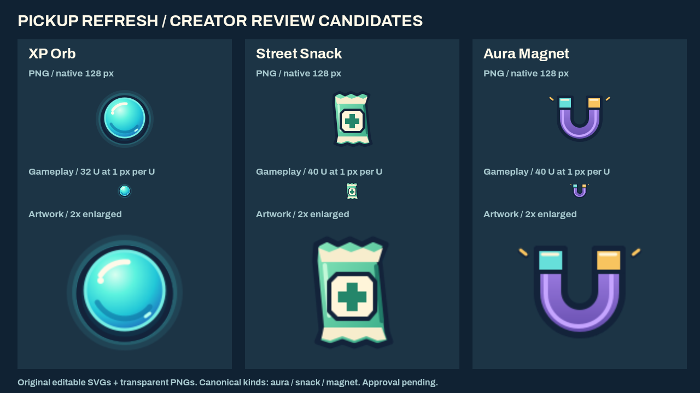
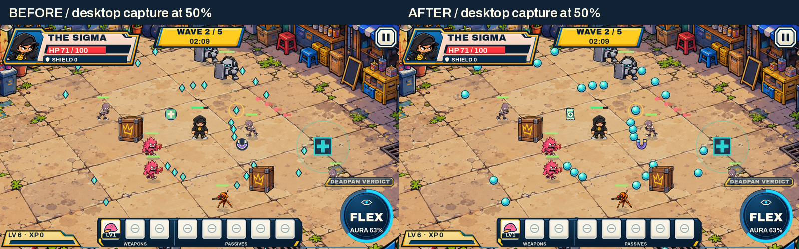
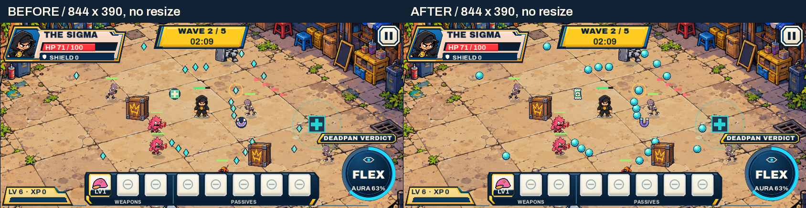

# M0 pickup refresh — creator review

Baseline: production `main`, `47f5f55331a4808c72200a7f25e0eae950cb7246`.
Candidate artwork is **pending explicit creator approval**. No approved source,
hero, gameplay rule, save contract, Web platform/DPR setting or deployment
configuration is replaced by this review. No merge or production release is authorized.

| Runtime kind | Player-facing name / proposed visual | Texture footprint |
|---|---|---|
| `aura` | XP Orb: round cyan core, ink rim and restrained baked halo | 32 U; phase 34 U plus the existing gold ring |
| `snack` | Street Snack: sealed mint/cream packet with healing badge | 40 U including transparent margins |
| `magnet` | Aura Magnet: open purple U, cyan/gold tips | 40 U including transparent margins |

The XP Orb name is the creator's canonical terminology decision. GDD changes
rename that noun only. The table records **proposed** candidate artwork for later
visual reconciliation; it does not approve or supersede existing art. All three
128×128 RGBA PNGs and editable self-contained SVGs are inventoried with SHA-256
in [the manifest](../../assets/art-candidates/pickups/v1/manifest.json).
No third-party art, fonts, filters or particle systems are used in these assets.

Full-resolution pairs: [desktop before](evidence/before-arena-1600x900.webp) /
[after](evidence/after-arena-1600x900.webp),
[mobile before](evidence/before-arena-844x390.webp) /
[after](evidence/after-arena-844x390.webp),
[dense before](evidence/before-dense-1600x900.webp) /
[after](evidence/after-dense-1600x900.webp), and
[dense mobile before](evidence/before-dense-844x390.webp) /
[after](evidence/after-dense-844x390.webp).

These are actual Godot 4.7.2 Compatibility/X11/llvmpipe captures of matching,
frozen review fixtures, not external mockups or human playthroughs. Normal and
dense fixtures contain 31/156 pickups, 9/75 canonical enemies, the two specials,
one phase orb, actual coral hostile shots, and the existing Safe Spot. The mint
packet silhouette differs from the station's large cross; the orb has an inset
core/rim/highlight rather than the hostile shot's flat dot. Selection radii are
not derived from artwork bounds. Both viewports retain identical fixture hashes
and RNG state before/after. Captures read the actual 1600×900 / 844×390 X11 client
area without resizing; mobile's internal fractional canvas readback is 843×390.
The desktop diptych explicitly displays its full captures at 50%; originals and
lossless RGB verification are retained in [capture provenance](evidence/captures.json).

The renderer preloads three textures once (192 KiB RGBA), submits one sprite per
pickup and retains the existing phase ring and optional 8% XP pulse. Reduced
Motion freezes that pulse. No recurring Image/Texture construction, particles,
Node creation or gameplay RNG calls are added. Historical phase helper/event
payloads stay byte-compatible; a presentation-only formatter displays XP ORB.

[CPU draw sampling](evidence/cpu-draw.json): six alternating A/B blocks, 243
pickups, 180 retained samples per renderer after warm-up. Median command
submission: **2.320 → 0.534 ms**; P95 **7.464 → 2.901 ms**; P99 **16.830 → 6.217 ms**.
This is a local CPU microbenchmark under software rendering, not GPU time,
delivered FPS, browser/device measurement or proof of Pixel 8a performance.
The creator's accepted Pixel 8a/Brave movement baseline is retained; a short
new-preview pickup/dense-scene device regression remains for creator review.

Reproduce after import using `tests/pickup_refresh/capture.gd -- before|after
1600 900 /output` (also `844 390`), `gallery.gd -- /output/sheet.png`, and
`measure.gd -- /output/cpu.json` with an X11 Compatibility display. ReviewRun
uses isolated default profiles and never writes player saves. The before
renderer is copied verbatim from the baseline. Tests/review sources do not ship.

Validation: `bash scripts/validate.sh` includes exact art/hash/pack negative
checks, pickup texture cache/transparency, visible name, Reduced Motion,
45/56/72 U boundaries, 18% healing, 80/120/160/200 phase XP, magnet near/far/phase
deduplication, disappearance and RNG checks. Existing recovery, frame-pacing
state traces, mobile input, hero/weapon/boss/profile suites remain mandatory.
`scripts/build_web.sh` verifies the exported textures and manifest and rejects
missing art or leaked review sources. The PR records authoritative CI, Web
build and protected preview identity for its exact final commit.
