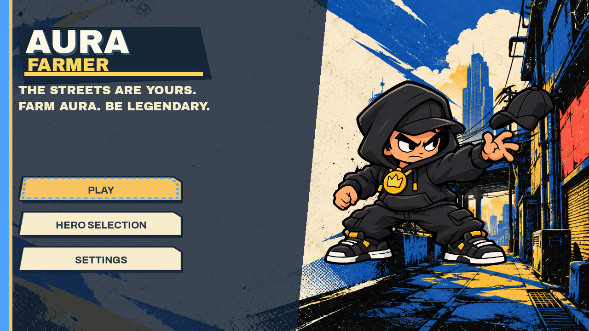
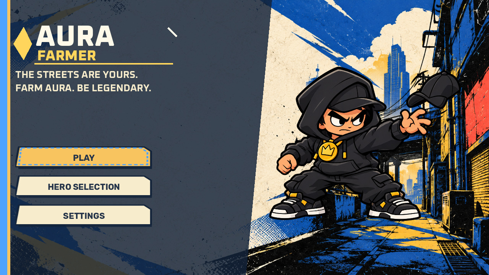
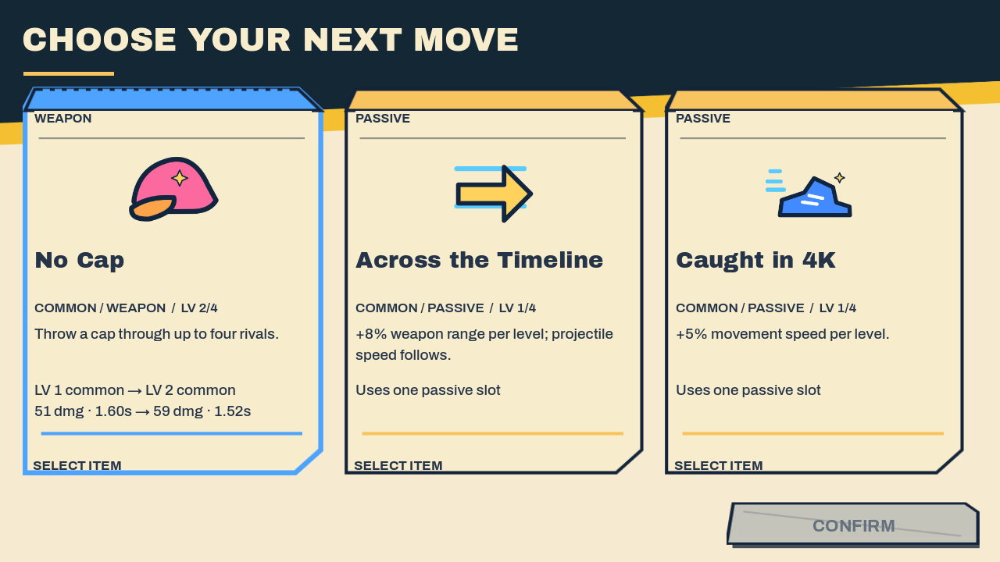
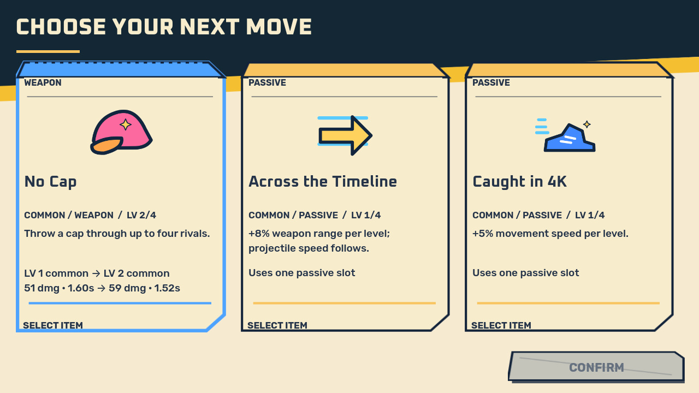
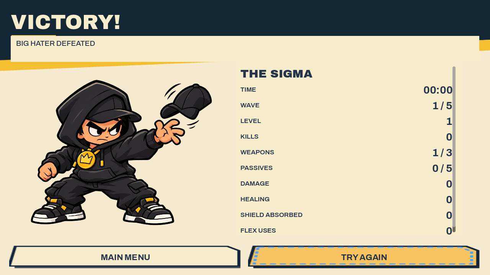
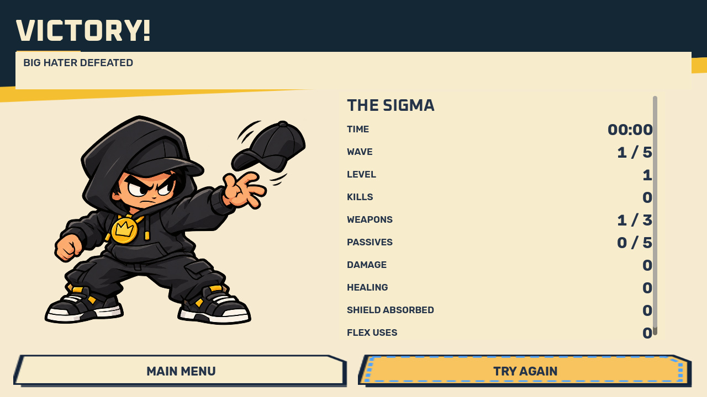

# Hero Clash — Phase 01 runtime typography review

**UNAPPROVED CANDIDATES. Production remains Clean Cut. No merge or release.**

This is a working Godot review path, not an art replacement. Launch `review.tscn` to play the real game with either candidate. Press **F8** to switch A/B. The production main scene, approved artwork, gameplay scripts and export presets are unchanged. Review profiles never write saves.

```sh
godot --path . tests/review_hero_clash/review.tscn -- --candidate=a
godot --path . tests/review_hero_clash/review.tscn -- --candidate=b
godot --headless --path . --script res://tests/review_hero_clash/test_review.gd
bash tests/review_hero_clash/capture_matrix.sh /absolute/capture/directory
```

## Compare the real renders

[Interactive side-by-side gallery](evidence/index.html) — download/open locally; GitHub displays HTML source. [All resolution/screen links](SCREENSHOTS.md) work directly on GitHub. Click individual images for their actual resolution.

| A — Clash Bold | B — Clash Circuit |
| --- | --- |
|  |  |
|  |  |
|  |  |

The game title is **Aura Farmer** in both. Candidate names are review labels only.

## Recommendation and observed tradeoffs

**Recommend B for the next creator review**, not automatic production adoption. Oxanium's angular forms give dynamic headings a recognizable hero-action character; Rubik keeps the numbers and descriptions separate from that display voice. B's compact title shapes retain a clearer distinction between headings and body copy on the 844 × 390 renders. Its technology-like tone is the main creative tradeoff and may be too futuristic for the intended street setting.

A is the more conservative Clean Cut continuation. Archivo Black provides a dense, broad headline silhouette, and Archivo has efficient small labels. It feels more grounded, but the broad display shapes consume more card-title width and need more wrapping. Both use normal upright outlines, with no synthetic slant or all-text heavy outlines.

The original concept board is **not attached or accessible in this workspace**. These candidates interpret the written Hero Clash brief. Visual fidelity to the selected third board remains unverified until the creator reattaches it. Neither these captures, their fonts nor CI constitute creator approval.

## Audit and preserved sources

Audit baseline: `main` / merge commit **0ac91747296d1c94d0ef8e73d925b7a6d77ec367**. At the initial GitHub check, PR #73 was already **merged/closed**, with head **cfb114cbf9f1a8a7468dad60ca001400005da6a9**, merged on 2026-10-28. It cannot be kept Draft after that merge; this work uses a separate review branch/Draft PR.

Read against `docs/GDD.md` V3 §§2, 7 and 8 (the Art Bible is §8), `docs/GDD_DECISION_REGISTER.md`, the 2026-10-24 Clean Cut and icon creator approvals, both runtime manifests, and `clean_cut_typography.gd`, `clean_cut_skin.gd`, `clean_cut_secondary.gd`. Existing Barlow/Barlow Condensed and Inter licensing were retained. The audit found a reusable existing role layer, but headline/body differentiation was weak, equipment names could exceed two lines, legendary descriptions could ellipsize, and the existing Flex control was rectangular.

The review adapter applies after the real skin's layout revision, caches font variations, preserves live Button signals, and changes only review presentation. It retains approved Sigma, Cool Kid, Alpha Chad, Ruin Alley, enemies, item icons and card artwork. It shortens equipment labels with full tooltip/build names, rebalances compact card text, gives menu copy a dark backing in portrait, and demonstrates a circular Flex button with an Aura arc and actual charging/READY values. World-space Safe Spot/combat annotation drawing retains the production font; it is outside this Control typography adapter.

### Explicit supersession required before production

- Approved runtime wordmark `assets/runtime-clean-cut/v2/support/wordmark.png`, SHA-256 **49eb4d1054d6675a5dad42ec3fa0352d202564e3aa655487d69365b2b9e83255**. Its approved vector source is `assets/art-production/character-hype-clean-cut/v2/shared/brand/aura-farmer-wordmark-candidate.svg`. Both remain untouched. The two new code-drawn lockups are only review candidates.
- Production Barlow typography roles in `scripts/clean_cut_typography.gd` and the GDD §8 typography contract require a recorded creator choice before adopting either pair.
- Replacing any Flex artwork in the approved V2 manifest would require separate asset supersession. This prototype changes only the review Button surface; it does not modify those files or their hashes.
- No supersession is proposed for the 19 original masters, 37 icons, 84 Clean Cut resources, character/environment/enemy identities, or canonical rules.

## Typography specification

`typography.gd` is the reusable source of truth. A uses **Archivo Black** for display and **Archivo** for UI. B uses **Oxanium** for display and **Rubik** for UI. Archivo Black is a static black design registered as Regular; it does not expose a 700/800 axis. B's display weights and both UI families use real variable-font axes. Axis keys are numeric OpenType tags; runtime tests verify that weight 700 actually resolves in Godot.

| Role | Family | Weight (B display / UI) | Desktop / compact logical px | Extra line spacing | Case |
| --- | --- | --- | --- | --- | --- |
| Brand Logo | Display | 800 | 64 / 48 token; vector lockup scales uniformly | 0 | Upper |
| Display XL | Display | 800 | 54 / 38 | 0 | Upper |
| Display Large | Display | 800 | 44 / 32 | 0 | Upper |
| Screen Heading | Display | 800 | 42 / 30 | 0 | Upper |
| Section Heading | Display | 700 | 26 / 23 | 2 | Upper |
| Hero Name | Display | 700 | 30 / 26; compact HUD 24 | 2 | Canonical name |
| Upgrade Card Title | Display | 700 | 29 / 26 | 2 | Canonical name |
| Rarity Label | UI | 700 | 16 / 16 | 1 | Upper |
| HUD Primary Stat | UI | 700 | 24 / 22 | 0 | Canonical |
| HUD Secondary Stat | UI | 600 | 17 / 17; equipment 16 | 1; equipment 0 | Canonical |
| Numeric Emphasis | UI | 700 | 28 / 26 | 0 | Unchanged |
| Ability Status | UI | 700 | 17 / 16 | 1 | Upper |
| Button Label | UI | 700 | 22 / 20 | 0 | Existing action label |
| Body Text | UI | 500 | 19 / 18; legendary 17 | 3; legendary 1 | Sentence content retained |
| Micro Label | UI | 600 | 16 / 16 | 1 | Upper |

All roles use **zero extra tracking**, natural font ascent/descent plus the listed line spacing. Numeric roles request tabular figures. Normal panel text uses existing semantic **ink #253449**, dark-surface text **paper #fff9e9**, and existing gold/blue/teal status colors. The adapter preserves those semantic colors rather than flattening selected, ready and disabled states. Panel text has no outline or shadow. Text marked as on-world receives a 1 px keyline and a dark 45% shadow offset (0,1). Logo A alone has a small graphic offset; logo B uses an original diamond/line lockup. Font geometry is never skewed or condensed synthetically.

Single-line text fits available width down to a 16 logical px floor. Wrapped descriptions retain their text. Compact landscape upgrade cards reposition existing content to keep descriptions/progression/CTA within the same screen; portrait lists scroll, rather than shrinking three/six cards into unreadable columns. Hover and build inspection retain full equipment identities.

## Font provenance and licensing

[Hash-pinned font manifest](fonts/manifest.json) records exact source URLs, bytes, SHA-256, license hashes, axes and glyph counts. Downloaded from the Google Fonts source repository; upstream project references are retained in each `METADATA.pb` and copyright notice.

| Pair | Source families | Available weights/width | Coverage inspected |
| --- | --- | --- | --- |
| A | Archivo Black / Archivo | Static Black; Archivo wght 100–900, wdth 62–125 (used at 100) | 423 / 653 mapped characters |
| B | Oxanium / Rubik | Oxanium 200–800; Rubik 300–900 | 357 / 885 mapped characters |

All four include the tested Portuguese accents, ASCII letters and digits. This is not a claim of complete worldwide localization coverage. The existing packaged Inter font supplies controlled symbol fallback; OS font fallback is disabled. No font binaries were edited.

Actual SIL OFL 1.1 license files were inspected and are redistributed alongside every family. They permit bundling, embedding and redistribution with software, require retention of copyright/license, prohibit selling the font alone, and constrain reserved-name use for modified versions. No reserved-name declaration appears in these copyright headers. Font software remains OFL; rendered game text does not acquire that license. The review Web export explicitly includes all four OFL files.

## External reference observations versus design judgments

- **Brawl Stars — factual source:** [Supercell's logo rationale, 24 August 2025](https://supercell.com/en/games/brawlstars/blog/news/brawl-stars-logo-is-changing/) explains reducing complexity, emphasizing the recognizable game name, improving small/contextual readability and retaining familiar colors/shapes. **Our judgment:** keep Aura Farmer's own title dominant and make the lockup distinct with few shapes. No Supercell lettering, skull, assets or composition were copied.
- **Brotato — direct visual observation:** [Blobfish's official Steam listing/screenshots](https://store.steampowered.com/app/1942280/Brotato/) show health/level information near an edge and a prominent central wave/countdown, with most space left for combat. **Our judgment:** separate numeric urgency from display flourishes; preserve the existing Aura Farmer arena and compact edge HUD. This is a visual reading of the screenshot, not a measured usability study or claim about its implementation.
- **Swarm — factual source:** [Riot's engineering article, 25 July 2025](https://www.riotgames.com/en/news/the-tech-behind-swarm) describes profiling hundreds of minions and addressing clumping, effects/overdraw and server costs. **Our judgment:** keep decorative typography in menus/headings, use stable high-contrast numbers in combat, and cache the review fonts/layout updates. No Swarm interface or hero artwork is reproduced; no performance gain is inferred from that article.

## Responsive and technical evidence

Both candidates were rendered in actual Godot 4.7.2 Compatibility at **1920×1080, 1600×900, 1280×720, 915×412, 844×390 and 390×844**, using identical seeded fixtures for menu, all-three-hero selection, HUD charging, HUD READY, three upgrades, six legendary options, victory and defeat. Scroll-bottom captures expose lower cards where needed. Fixture victories are staged, not completed runs.

The existing canvas scale produces a 1280×720 logical desktop viewport and a 520 px minimum logical mobile dimension. A 16 logical px micro/equipment label therefore reaches about **12 physical px on the smallest mobile captures**; body copy is about 13.5–14.25 px. Essential HP/time/Flex values remain larger. This is the current compact-readability limit, not physical-device acceptance. The circular Flex target is 128 logical px (about 96 physical px at 0.75 scale). Portrait preserves an open central combat region and a two-row equipment bar; landscape keeps the bar on one row. Lists/results use existing scrolling when content exceeds available height.

The per-resolution JSON files retain measured label roles, font sizes, line counts and rectangles. No measured Label reported fewer visible lines than its shaped line count in the captured fixtures; intentional ScrollContainer clipping is separately represented by bottom views. This checks the fixtures, not every possible localized string. Review fonts and original names remain editable runtime text.

A real production Web export passed PCK inspection: 37 approved icons, 84 Clean Cut resources, 19 original masters, existing production fonts/licenses, and **zero Hero Clash review paths or imported candidate fonts**. A separate local review Web export embedded all four candidate font resources and all four licenses successfully. `export_review.py` prepares that separate project without changing production presets. Browser WebGL2 execution and physical-device touch/performance are **not verified by these native captures/export checks**.

[Validation summary](evidence/validation.json) and [retained check output](evidence/validation.log) cover all 51 named Godot phases, including the new candidate weight/coverage/control checks. Validation was completed in two batches. An initial existing keyboard test expected a fresh profile; it passed with isolated test user data.

The creator must choose typography and logo direction before any production replacement. This remains a Draft review, not M0 acceptance.
