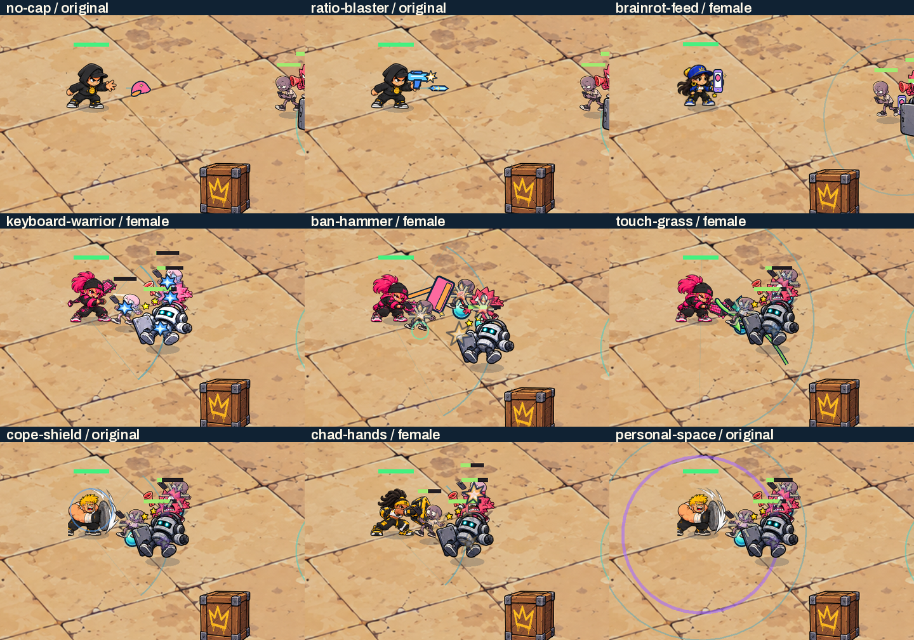

# M0 weapon presence — creator review

Baseline: production `main` after #98, `bd66c202595eabcdf7f8f23b28887f19b28d840b`.
This is a presentation candidate. **No merge, production deployment or artistic
approval is authorized.** All six character masters and the approved pickups
remain byte-identical. No Phaser, backend, density, passive, XP or balance change.

[Matched starter before/after video](evidence/starter-before-after.mp4) ·
[Before, full size](evidence/before-starters.mp4) ·
[After, full size](evidence/after-starters.mp4) ·
[Remaining six weapons](evidence/remaining-weapons.mp4) ·
[Actual Legendary burst / sweep / slam](evidence/legendary.mp4)

| Weapon | Integrated presentation |
|---|---|
| No Cap | Exact approved cap travels with the real piercing projectile; authored throw pose at release and contact burst only on a resolved hit. Existing Sigma marked-target/Flex cue stays intact. |
| Ratio Blaster | Approved handheld blaster where the master has no built-in gun, muzzle accent, original directional bolt and actual-contact impact. Real Legendary extra shots remain individually visible. |
| Brainrot Feed | Handheld phone, original fixed-position countdown area, phone/feed mark and compact activation wave; actual Legendary secondary areas use their real positions/radii. |
| Keyboard Warrior | Preserve authored keyboards in Cool Kid/Byte Baddie; retime approved execution poses to the actual paired strikes and show distinct contacts at their real deadlines. |
| Ban Hammer | Approved hammer attached at its handle; raise/swing into the real 0.30 s impact, localized contacts and the canonical Legendary line echo. |
| Touch Grass | Exact approved **v2** whip, hand-mounted sweep and green tether constrained inside the real sector; actual enhanced 360° Legendary geometry. |
| Cope Shield | Preserve the authored original/female shields, use actual bash execution and show barrier feedback only while real weapon-granted shield HP remains. |
| Chad Hands | Preserve authored fists/gauntlets, separate actual paired contacts and emphasize the real successful-third-activation slam/radius. |
| Personal Space | Full functional outer boundary at activation, with an expanding cosmetic inner band contained inside it; actual weapon shield sources drive barrier feedback. |

The eight V5 and Touch Grass v2 approved PNGs are reused without editing. New
art is limited to one transparent bolt and a three-cell impact sheet, with
editable SVGs. [Exact provenance/hashes](../../assets/art-candidates/weapon-presence/v1/manifest.json)
cover both new assets, all nine source references and six attachment profiles.
**The new VFX, mounting, motion and combat use of those existing icons remain
subject to creator visual approval.** No approved art needs source supersession.

Props use explicit foot-pivot hand anchors for anticipation/execution/recovery
on each appearance and reflect once. Existing embedded keyboards, shields and
gauntlets are preserved rather than covered with duplicate equipment. Only the
active prop is shown. Dynamic aim updates the local pose descriptor without
writing the canonical facing used by Flex. Hurt, defeat and Flex retain their
original animation priority and facing. There are no new character frames.

`weapon_presentation.gd` observes queued shot/area dictionaries and actual HP or
Shield changes after authoritative resolution. It never edits those models,
calls damage/collision functions, samples RNG or advances simulation. Cancelled
queues cannot turn into cosmetic attacks; misses produce no success flash;
shield-only contact has its own deflection. Existing serialized visual/event
arrays remain intact for deterministic compatibility. Hostile warnings/fire
render above friendly decoration. Enemy recoil is a render-only offset up to
2.5 U, disabled for warning/charge/boss states and Reduced Motion.

The fixed pools contain 24 gestures and 48 contacts, with bounded reaction/cue
indexes. No particles or runtime nodes are added. Two new textures total 72 KiB
raw RGBA; the nine 256px props share the existing ResourceLoader cache (at most
2.25 MiB raw). Assets preload once. Actual level/rarity strengthens small contact
detail; it does not expand a hitbox, damage radius or attack count. Reduced
Motion removes decorative cap banking, prop sweeps and reaction movement,
retaining real travel, contact timing and functional boundaries.

[Desktop combat](evidence/desktop-combat.webp) ·
[Mobile landscape](evidence/mobile-combat.webp) ·
[Dense mobile / hostile warning](evidence/dense-mobile.webp) ·
[Six appearance samples](evidence/six-appearances.webp)

Evidence is real Godot 4.7.2 Compatibility/X11/llvmpipe, controlled simulation
and isolated review profiles. The reels use Movie Maker's **offline fixed 30
FPS**, 1280×720 output. They are not delivered FPS, human gameplay, browser or
physical-device recordings. The side-by-side reel scales each original to
640×360 and labels both sides. Separate X11 captures are 1600×900 and 844×390;
the internal fractional mobile framebuffer can be one pixel narrower. Dense
fixtures deliberately protect player HP for controlled cost/readability checks.
Weapon reels use canonical hero health and weapon rules, with each isolated
fixture equipping its named existing weapon. Legendary demonstrations use
protected player/target HP so the real repeated-activation mechanics are visible.

Mandatory validation includes existing full seeded runs, frame-pacing state
hashes, all hero/appearance/save/retry/input/weapon/boss/pickup contracts, plus
3,456 exact per-frame comparisons across all nine weapons, both appearances,
common L4 and Legendary. Targeted tests cover delayed/paired/launch/miss/blocked
and cancelled events, manual aim, pose priority, Reduced Motion and bounded
pools. Packaging checks require exact new/reused bytes, the manifest and source
exclusion. [Capture provenance](evidence/provenance.json) and
[performance comparison](evidence/performance.json) record the observed scope.

Four alternating 844×390 software-renderer blocks retained 240 samples per
version after warm-up (up to 71 enemies, 31 new contacts and three gestures).
CPU drawing submission median was **1.632 → 1.707 ms**; renderer CPU median
**5.195 → 5.699 ms**; the software GL timer median **6.962 → 6.937 ms**.
Drawing P95 was **2.897 → 2.288 ms**. These timings show the local cost and its
variation, not a causal simulation speedup or Android frame-pacing result.
Draw-call counters were unavailable on this Compatibility backend.

The accepted Pixel 8a/Brave baseline is preserved without DPR, camera, touch,
simulation scheduling or speed changes. Software-renderer comparisons cannot
certify Android frame pacing; a short exact-preview physical regression and
creator visual review remain pending. The PR records mandatory CI, the exact
tested Web preview SHA and current protection. No production release is made.
